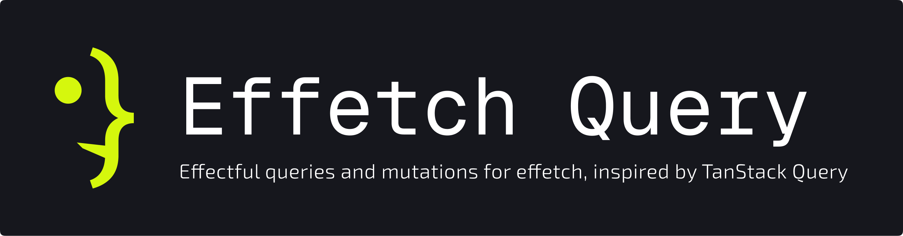

<h1>
  
</h1>

[](https://www.npmjs.com/package/@monarcode/effetch-query)
[](https://github.com/monarcode/effetch-query/actions/workflows/ci.yml)
[](https://bundlejs.com/?q=@monarcode/effetch-query&config=%7B%22esbuild%22%3A%7B%22external%22%3A%5B%22effect%22%2C%22effect%2F%2A%22%2C%22%40effect%2Fatom-react%22%2C%22react%22%2C%22react%2F%2A%22%2C%22%40monarcode%2Feffetch%22%2C%22%40monarcode%2Feffetch%2F%2A%22%5D%7D%7D)
[](https://www.npmjs.com/package/@monarcode/effetch-query)
[](https://www.npmjs.com/package/@monarcode/effetch-query#provenance)
[](./LICENSE)

[](#showing-data-in-react)
[](#react-native)
[](#tanstack-router-and-start)
[](#tanstack-router-and-start)
[](#react-router)
[](#nextjs)
[](https://effect.website)

**Server state for [Effect](https://effect.website) apps, inspired by
[TanStack Query](https://tanstack.com/query).**

Most of what an app shows comes from a server: a list of todos, a profile,
the price of something. Effetch Query loads that data once, shares it
between every component that shows it, keeps it fresh in the background,
and updates it when you change something.

Everything in it is Effect. A query is an Effect that runs with your app's
services, its errors stay typed all the way to the component, and the
cache itself is something your Effect programs can read and write. It
works in React, React Native and code with no UI at all.

It's the companion to [Effetch](https://github.com/monarcode/effetch), the
typed HTTP client for Effect: Effetch makes the call, Effetch Query caches
it. It works with any Effect too.

> **Release candidate.** The API is frozen for `0.1.0`: the
> `0.1.0-rc.N` releases fix bugs and only ever add to it. See the
> [release notes](./CHANGELOG.md).

## Contents

- [Why Effetch Query](#why-effetch-query)
- [How it works](#how-it-works)
- [At a glance](#at-a-glance)
- [Getting started](#getting-started)
  - [Install](#install)
  - [1. Describe your API](#1-describe-your-api)
  - [2. Create the query client](#2-create-the-query-client)
  - [3. Define your queries](#3-define-your-queries)
  - [4. Show a query](#4-show-a-query)
  - [5. Change data](#5-change-data)
  - [Where to go next](#where-to-go-next)
- [Queries](#queries)
  - [Queries from endpoints](#queries-from-endpoints)
  - [Keys](#keys)
  - [Queries that read other queries](#queries-that-read-other-queries)
  - [Errors](#errors)
  - [Errors by status](#errors-by-status)
  - [Freshness and refetching](#freshness-and-refetching)
  - [Query options](#query-options)
  - [Placeholders](#placeholders)
  - [Options for `fromClient`](#options-for-fromclient)
- [Showing data in React](#showing-data-in-react)
  - [Read a query](#read-a-query)
  - [Read a query as an object](#read-a-query-as-an-object)
  - [Select part of a value](#select-part-of-a-value)
  - [Read many queries](#read-many-queries)
  - [Suspense and error boundaries](#suspense-and-error-boundaries)
  - [Pause screens you can't see](#pause-screens-you-cant-see)
  - [Refetch on demand](#refetch-on-demand)
  - [Atoms](#atoms)
- [Mutations](#mutations)
  - [Define a mutation](#define-a-mutation)
  - [Run a mutation](#run-a-mutation)
  - [Mutation options](#mutation-options)
  - [Invalidate after a mutation](#invalidate-after-a-mutation)
  - [Optimistic updates](#optimistic-updates)
  - [Entities](#entities)
  - [Run modes](#run-modes)
  - [Show activity](#show-activity)
- [Working with the cache](#working-with-the-cache)
  - [From Effect](#from-effect)
  - [Outside Effect](#outside-effect)
  - [Sign out and switch accounts](#sign-out-and-switch-accounts)
- [Infinite queries](#infinite-queries)
  - [Load more](#load-more)
- [Live queries](#live-queries)
  - [A query from a stream](#a-query-from-a-stream)
  - [Pushes on a fetched query](#pushes-on-a-fetched-query)
- [React Native](#react-native)
- [Without Effetch](#without-effetch)
- [Server rendering](#server-rendering)
  - [Send the cache](#send-the-cache)
  - [Load it in the browser](#load-it-in-the-browser)
  - [Streaming](#streaming)
- [Frameworks](#frameworks)
  - [TanStack Router and Start](#tanstack-router-and-start)
  - [Next.js](#nextjs)
  - [React Router](#react-router)
- [The client](#the-client)
- [Testing](#testing)
- [Coming from TanStack Query](#coming-from-tanstack-query)
- [API reference](#api-reference)
  - [`@monarcode/effetch-query`](#monarcodeeffetch-query)
  - [`@monarcode/effetch-query/react`](#monarcodeeffetch-queryreact)
  - [`@monarcode/effetch-query/effetch`](#monarcodeeffetch-queryeffetch)
  - [`@monarcode/effetch-query/react-native`](#monarcodeeffetch-queryreact-native)
  - [`@monarcode/effetch-query/react/tanstack-router`](#monarcodeeffetch-queryreacttanstack-router)
  - [Limitations](#limitations)
- [Examples](#examples)
- [Development](#development)
- [License](#license)

## Why Effetch Query

Effetch Query started in real frontend projects built with Effect and
Effetch. Their API calls were Effects, with typed errors, services and
retries. Their UI used TanStack Query, the standard way to cache server
data in React. Joining the two meant writing a bridge: run each Effect into
a promise, hand the promise to TanStack Query, and turn its errors back
into something the UI could match on.

That bridge was where the trouble lived. Past the promise, errors lost
their Effect types, a query couldn't use the app's layers, and stopping an
Effect that was no longer needed took wiring of its own. Effetch had made
each call effectful; what was still missing was a cache built on Effect.

Effetch Query is that cache. Instead of patching TanStack Query, it brings
the parts of it that make apps feel fast into Effect itself: one fetch
shared by every component, fresh data in the background, optimistic
updates and invalidation by key.

**With thanks to TanStack Query.** Effetch Query owes its model, its
vocabulary and many of its defaults to
[TanStack Query](https://tanstack.com/query). If you know it, you'll feel
at home here, and [Coming from TanStack Query](#coming-from-tanstack-query)
maps one to the other. TanStack Query is the industry standard for data
fetching, and the right choice for most apps. Effetch Query is an
alternative for people building their apps with Effect, who want their
server state to be Effect as well.

Want to keep TanStack Query and still write your frontend with Effect?
Watch [tanstack-effect-bridge](https://github.com/monarcode/tanstack-effect-bridge),
our next project.

## How it works

Six ideas carry the whole library. Each gets a section of its own later;
this is the short version.

**A query is an Effect with a key.** You describe how to load something,
such as `GET /todos/1`, and give it a key, such as `["todos", 1]`. The key
is how the cache finds the value again, and how you refer to it later,
say to refetch every query under `["todos"]`. With Effetch, an endpoint's
route gives you the key, so you rarely write one.

**The query client holds the cache.** Queries hold no data themselves.
Values live in a query client, which runs queries with your app's
services and keeps what they return. A browser app has one client; a
server makes one per request.

**Values are fresh, then stale.** A value counts as fresh for the query's
`staleTime` after it's fetched, and stale after that. A stale value is
still shown, and refetched in the background when a component starts
using the query, when the app comes back into focus, or when you say it's
out of date. A query that nothing uses keeps its value for its `gcTime`,
then lets it go.

**A result says where a query is.** Reading a query gives an
`AsyncResult` from Effect:

- `Initial`, before there's a value;
- `Success`, with the value;
- `Failure`, with the full `Cause`, so you can tell a 404 from a network
  error from a bug.

Each also has a `waiting` flag, true while a fetch is in progress. A
background refetch shows the old value with `waiting: true`, so a
component can keep showing it and add a spinner.

**A mutation changes data, and says what's out of date.** A mutation runs
an Effect that changes something on the server, such as toggling a todo.
When it succeeds, it invalidates the queries it names, and the ones on
screen refetch. It can also write to the cache straight away, an
optimistic update, and that write is undone if the mutation fails.

**Your services are typed.** You tell Effetch Query once which services
your app provides, such as your API client. Queries and mutations can use
them, a query that needs anything else doesn't compile, and a client made
without a layer that provides them doesn't compile either.

React only subscribes to all of this: the cache is built on Effect's own
reactivity (`effect/reactivity` atoms), so the same queries work in
components, in route loaders, on the server, and in plain Effect code.

## At a glance

Here's a whole React app in one file. It lists the todos from an API and
toggles one when you click it:

```tsx
import * as FetchHttpClient from "effect/http/FetchHttpClient";
import * as Layer from "effect/Layer";
import * as AsyncResult from "effect/reactivity/AsyncResult";
import * as Schema from "effect/Schema";

import * as Fetch from "@monarcode/effetch";
import { QueryClient } from "@monarcode/effetch-query";
import { fromClient } from "@monarcode/effetch-query/effetch";
import {
  QueryProvider,
  useMutation,
  useQuery,
} from "@monarcode/effetch-query/react";

const Todo = Schema.Struct({
  id: Schema.Finite,
  title: Schema.String,
  done: Schema.Boolean,
});

// Your Effetch client, as a service.
class ApiClient extends Fetch.Service<ApiClient>()("ApiClient", {
  baseUrl: "https://api.example.com",
}) {}

declare module "@monarcode/effetch-query" {
  interface Register {
    readonly services: ApiClient;
  }
}

const api = fromClient(ApiClient);

// A cached query for each call of the endpoint.
const todos = api.query(
  Fetch.endpoint("GET /todos", { output: Schema.Array(Todo) }),
  { staleTime: "1 minute" },
);

// A mutation that refetches the todos once it succeeds.
const toggleTodo = api.mutation(
  Fetch.endpoint("PATCH /todos/:id", {
    input: Schema.Struct({ done: Schema.Boolean }),
    output: Todo,
  }),
  { invalidates: [todos] },
);

// The cache, which runs queries with your services.
const queryClient = QueryClient.make({
  layer: ApiClient.layer.pipe(Layer.provide(FetchHttpClient.layer)),
});

export function App() {
  return (
    <QueryProvider client={queryClient}>
      <Todos />
    </QueryProvider>
  );
}

function Todos() {
  const result = useQuery(todos());
  const toggle = useMutation(toggleTodo);

  return AsyncResult.match(result, {
    onInitial: () => <p>Loading…</p>,
    onFailure: () => <p>Couldn't load your todos.</p>,
    onSuccess: ({ value }) => (
      <ul>
        {value.map((todo) => (
          <li
            key={todo.id}
            onClick={() =>
              void toggle.run({
                params: { id: todo.id },
                body: { done: !todo.done },
              })
            }
          >
            {todo.done ? "✓" : "○"} {todo.title}
          </li>
        ))}
      </ul>
    ),
  });
}
```

The rest of this guide builds the same app one piece at a time, then goes
deeper into each piece.

## Getting started

This section walks you through a small todo app: an Effetch client, a
query client, two queries, a component that shows them, and a mutation
that changes them. Later sections build on the same files, so each
example names the file it lives in.

### Install

Install the package with Effetch and Effect:

```bash
pnpm add @monarcode/effetch-query @monarcode/effetch effect
```

For React, add `@effect/atom-react` and `react` (19):

```bash
pnpm add @effect/atom-react react
```

Effetch Query needs `effect` 4.1 or later. It runs in browsers, React
Native (Hermes), Node 20+, Bun and Deno.

### 1. Describe your API

Start with an Effetch client for your API, declared as a service with
`Fetch.Service`. If you already use Effetch, you have this file:

```ts api.ts
import * as FetchHttpClient from "effect/http/FetchHttpClient";
import * as Layer from "effect/Layer";
import * as Schema from "effect/Schema";

import * as Fetch from "@monarcode/effetch";

export const Todo = Schema.Struct({
  id: Schema.Finite,
  title: Schema.String,
  done: Schema.Boolean,
});
export type Todo = typeof Todo.Type;

// What the API sends back when a request fails.
export const ApiError = Schema.Struct({ message: Schema.String });

export class ApiClient extends Fetch.Service<ApiClient>()("ApiClient", {
  baseUrl: "https://api.example.com",
  defaultError: ApiError,
}) {}

// Sends requests with the browser's `fetch`.
export const ApiClientLive = ApiClient.layer.pipe(
  Layer.provide(FetchHttpClient.layer),
);

// The services your queries and mutations can use.
declare module "@monarcode/effetch-query" {
  interface Register {
    readonly services: ApiClient;
  }
}
```

The `declare module` block at the end is the one piece of setup that's
specific to Effetch Query. It tells the library which services your
queries run with. Write it once, anywhere in your app. From then on:

- a query that uses a service you haven't registered doesn't compile;
- the client must be given a layer that provides every registered
  service.

With several services, use a union: `ApiClient | Analytics`.

### 2. Create the query client

The query client holds the cache. Give it the layer that provides your
services, and it builds the layer the first time a query needs it:

```ts client.ts
import { QueryClient } from "@monarcode/effetch-query";

import { ApiClientLive } from "./api.js";

export const queryClient = QueryClient.make({
  layer: ApiClientLive,
  queries: {
    // Data counts as fresh for 30 seconds after it's fetched.
    defaults: { staleTime: "30 seconds" },
  },
});
```

One client is enough for a browser app. On a server, you make one per
request, as [Server rendering](#server-rendering) shows. Every option the
client takes is listed in [The client](#the-client).

### 3. Define your queries

`fromClient` takes your Effetch client and turns its endpoints into
queries. Calling the result with an endpoint's params gives you one
cached query per call:

```ts todos.ts
import * as Schema from "effect/Schema";

import * as Fetch from "@monarcode/effetch";
import { fromClient } from "@monarcode/effetch-query/effetch";

import { ApiClient, Todo } from "./api.js";

// Queries and mutations that call your API through ApiClient. Its
// defaultError types their errors.
export const api = fromClient(ApiClient);

export const listTodos = Fetch.endpoint("GET /todos", {
  output: Schema.Array(Todo),
});
export const getTodo = Fetch.endpoint("GET /todos/:id", { output: Todo });

export const todos = api.query(listTodos);
// todos({ query: { done: false } }) is the query keyed ["todos", { done: false }]

export const todo = api.query(getTodo, { staleTime: "1 minute" });
// todo({ params: { id: 1 } }) is the query keyed ["todos", 1]
```

Define queries at module level, as you do your schemas. A query is only a
description: nothing is fetched until something reads it, and the data
lives in the client.

**Without endpoints.** You can also call your Effetch client yourself.
`Query.make` defines one query, and `Query.family` defines one query per
argument, each from an Effect you write:

```ts
import * as Schema from "effect/Schema";

import { Query } from "@monarcode/effetch-query";

import { ApiClient, Todo } from "./api.js";

export const todos = Query.family({
  key: ["todos", "list"],
  run: (filter: { readonly done: boolean }) =>
    ApiClient.use((client) =>
      client.get("/todos", { query: filter, output: Schema.Array(Todo) }),
    ),
});
// todos({ done: false }) is the query keyed ["todos", "list", { done: false }]

export const todo = Query.family({
  key: ["todos", "detail"],
  run: (id: number) =>
    ApiClient.use((client) =>
      client.get("/todos/:id", { params: { id }, output: Todo }),
    ),
  staleTime: "1 minute",
});
// todo(1) is the query keyed ["todos", "detail", 1]
```

These work the same as endpoint queries, with the same typed errors. The
difference is what you write yourself: the key, which an endpoint takes
from its route, and a `schema` for [server rendering](#server-rendering),
which an endpoint takes from its `output`.

### 4. Show a query

`useQuery` reads a query in a component. The first time, it fetches. After
that, it shows the cached value, and refetches in the background when the
value is stale:

```tsx open-todos.tsx
import * as AsyncResult from "effect/reactivity/AsyncResult";

import { useQuery } from "@monarcode/effetch-query/react";

import { todos } from "./todos.js";

export function OpenTodos() {
  const result = useQuery(todos({ query: { done: false } }));

  return AsyncResult.match(result, {
    onInitial: () => <p>Loading…</p>,
    onFailure: () => <p>Couldn't load your todos.</p>,
    onSuccess: ({ value }) => (
      <ul>
        {value.map((todo) => (
          <li key={todo.id}>{todo.title}</li>
        ))}
      </ul>
    ),
  });
}
```

`AsyncResult.match` gives you one branch per state: `Initial` while the
first fetch is in progress, then `Success` or `Failure`.

To give your components the client, wrap your app in `QueryProvider`:

```tsx App.tsx
import { QueryProvider } from "@monarcode/effetch-query/react";

import { queryClient } from "./client.js";
import { OpenTodos } from "./open-todos.js";

export function App() {
  return (
    <QueryProvider client={queryClient}>
      <OpenTodos />
    </QueryProvider>
  );
}
```

Two components that show `todos({ query: { done: false } })` share one
fetch and one cached value.

### 5. Change data

A mutation changes data on the server. Its `invalidates` option names the
queries that are out of date once it succeeds, and the ones on screen
refetch:

```ts toggle-todo.ts
import * as Schema from "effect/Schema";

import * as Fetch from "@monarcode/effetch";

import { Todo } from "./api.js";
import { api, todos } from "./todos.js";

export const toggleTodo = api.mutation(
  Fetch.endpoint("PATCH /todos/:id", {
    input: Schema.Struct({ done: Schema.Boolean }),
    output: Todo,
  }),
  { invalidates: [todos] },
);
```

`useMutation` runs it from a component. For an endpoint mutation, the
variables you pass to `run` are the endpoint's call options:

```tsx
import * as AsyncResult from "effect/reactivity/AsyncResult";

import { useMutation } from "@monarcode/effetch-query/react";

import type { Todo } from "./api.js";
import { toggleTodo } from "./toggle-todo.js";

export function ToggleButton({ todo }: { readonly todo: Todo }) {
  const { result, run } = useMutation(toggleTodo);

  return (
    <button
      disabled={result.waiting}
      onClick={() =>
        void run({ params: { id: todo.id }, body: { done: !todo.done } })
      }
    >
      {AsyncResult.isFailure(result)
        ? "Try again"
        : todo.done
          ? "Undo"
          : "Done"}
    </button>
  );
}
```

**Without endpoints.** `Mutation.make` defines a mutation from an Effect
you write. Its variables are whatever its `run` takes, here the todo to
toggle:

```ts
import { Mutation } from "@monarcode/effetch-query";

import { ApiClient, Todo } from "./api.js";

export const toggleTodo = Mutation.make({
  run: (todo: Todo) =>
    ApiClient.use((client) =>
      client.patch("/todos/:id", {
        params: { id: todo.id },
        body: { done: !todo.done },
        output: Todo,
      }),
    ),
  // A key reaches every query under it, endpoint or not.
  invalidates: [["todos"]],
});
// useMutation(toggleTodo).run(todo)
```

### Where to go next

That's the whole loop: define a query, show it, change the data, and let
the cache refetch. The rest of this guide goes deeper, in the same order:

- [Queries](#queries): keys, errors, freshness and placeholders.
- [Showing data in React](#showing-data-in-react): every way to read a
  query in a component, with Suspense, selections and paused screens.
- [Mutations](#mutations): invalidation, optimistic updates, entities and
  activity.
- [Working with the cache](#working-with-the-cache): reading and writing
  the cache from Effect and from plain code, and signing out.
- [Infinite queries](#infinite-queries) and
  [Live queries](#live-queries), for lists that load in pages and values
  a server pushes.
- [React Native](#react-native), [Server rendering](#server-rendering)
  and [Frameworks](#frameworks), for your platform.
- [The client](#the-client), [Testing](#testing) and the
  [API reference](#api-reference), for everything else.

## Queries

A query is an Effect with a key, and the client keeps what it returns.
This section covers how queries are made from endpoints, how keys work,
how one query reads another, what a failure holds, when a value is
refetched and every option a query takes. After it, you can define any
query your app needs and say how fresh it should stay.

### Queries from endpoints

`api.query`, `api.infiniteQuery` and `api.mutation` add no behaviour of
their own: they call your endpoint through your Effetch client, and take a
query's or mutation's options. What `api.query` returns is a family: call
it with the endpoint's `params` and `query` to get the query for that
call.

- **Keys come from the route:** the path with its params filled in, then
  the query object. `GET /todos/:id` with `{ params: { id: 1 } }` is
  `["todos", 1]`, so invalidating `["todos"]` reaches every todos
  endpoint.
- **Errors are typed from the endpoint and the client:** `todo`'s error is
  `NetworkError | DecodeError | HttpError.With<{ message: string }>`, with
  your plugins' errors if you use any, and your own errors by status
  ([Errors by status](#errors-by-status)).
- **`query` takes endpoints without a body** (`GET`, `HEAD`, `OPTIONS`,
  `TRACE`). Everything else is a `mutation`, whose variables are the
  call's options ([Mutations](#mutations)).
- **As a target, an endpoint query matches its own queries only:**
  `Query.invalidate(todo)` reaches every `todo({ params })`, not
  `GET /todos` or `GET /todos/:id/comments` ([Keys](#keys)).
- **Server rendering needs nothing extra** when the endpoint has an
  `output`: it's the schema the value crosses to the browser with
  ([Server rendering](#server-rendering)).
- **`headers` and `plugins` are options of the query,** as with Effetch's
  `client.bind`, not arguments of each call: the call's arguments make the
  key, and a header shouldn't.

The argument a call takes is an `EndpointQueryArgs`: the route's `params`,
and a `query` object, typed by the endpoint's `query` schema if it has
one. Here it is on its own, for a helper that builds one:

```ts
import type { EndpointQueryArgs } from "@monarcode/effetch-query/effetch";

import { todo } from "./todos.js";

export const firstTodoArgs: EndpointQueryArgs<"GET /todos/:id"> = {
  params: { id: 1 },
};

export const firstTodo = todo(firstTodoArgs);
// the query keyed ["todos", 1]
```

**Calls that send the same request share a query.** What isn't sent
doesn't count, so `params` the path doesn't name and arrays left empty
are ignored, as are `null` and `undefined` query values and array items.
Without a `query`
schema, values are otherwise compared as given, so `{ page: 1 }` and
`{ page: "1" }` are two queries. With one, they're compared as they're
sent ([Keys](#keys)).

Make one `api.query` per endpoint: two of the same route would share keys
but not their cache.

### Keys

A key is an array that identifies a query in the cache, such as
`["todos", 1]`. Keys are hierarchical: invalidating `["todos"]` reaches
every key that starts with it, so the broadest part comes first. Parts
are compared by value (`Equal.equals`), so `{ done: false }` matches
`{ done: false }`.

Keep keys to JSON values (strings, numbers, booleans, `null`, arrays and
plain objects): with server rendering, they're sent to the browser.

**A family's key is a prefix.** Each member's key is the family's `key`
with its argument added: `Query.family({ key: ["todos", "detail"] })`
called with `1` is `["todos", "detail", 1]`. An endpoint family's key is
its route's path up to the first param, so `todo.key` is `["todos"]`.

**A prefix for each backend.** An endpoint's key has no method, scheme or
host. For a second backend with the same paths,
`fromClient(Client, { key: ["billing"] })` puts a prefix before every key
it makes, as [Options for `fromClient`](#options-for-fromclient)
shows.

#### Targets

`Query.invalidate`, `Query.refetch`, `Query.reset`, `Query.clear`, a
mutation's `invalidates` and `useRefetch` take a **target**, which says
which queries to act on. A target is one of these:

- a query, such as `todo({ params: { id: 1 } })`: that key only;
- a family, such as `todos`: every query whose key starts with the
  family's, except that an endpoint family matches only its own queries;
- a key, such as `["todos"]`: every query whose key starts with it, so
  `[]` matches every query;
- a group, made with `Query.group`: every query one of its targets
  matches.

A group combines targets that share no key, such as the queries one
screen shows. It matches each query once, and is a target like any other:

```ts
import { Query } from "@monarcode/effetch-query";

import { todo, todos } from "./todos.js";

// The two todos endpoints, and nothing else under ["todos"].
export const todoEndpoints = Query.group(todos, todo);

export const refreshTodos = Query.refetch(todoEndpoints);
```

`Query.group` returns a `Query.Group`, whose `targets` lists what it
combines; a group passed to it is flattened into it. Writes don't take a
group, since one value can't fit queries of different types: `Query.set`
and `Query.update` take one query or family.

Pass the targets one by one, not as an array. An array of queries is a
key, not a group, and as a key it would match nothing, so
`Query.GroupTargets` makes `Query.group([todos, todo])` a type error. Where
a target is expected, though, `[todos, todo]` compiles, since it's a
valid key, and fails at run time with a `KeyHoldsTargetError` defect.
Combine targets with `Query.group`.

#### Keys from a query schema

**An endpoint with a `query` schema** (Effetch's `query` option on
`Fetch.endpoint`) is keyed by its query as it's sent: each value encoded
to a string, as in the URL. A `Date` is its ISO string, `2` is `"2"`, and
a field renamed with `Schema.encodeKeys` has its sent name. So equal
requests share a query, and the key is JSON for server rendering:

```ts
import * as Schema from "effect/Schema";

import * as Fetch from "@monarcode/effetch";

import { Todo } from "./api.js";
import { api } from "./todos.js";

export const searchTodos = api.query(
  Fetch.endpoint("GET /todos/search", {
    output: Schema.Array(Todo),
    query: Schema.Struct({
      due: Schema.Date,
      page: Schema.optional(Schema.Finite),
    }),
  }),
);

searchTodos({ query: { due: new Date("2026-11-16"), page: 2 } });
// keyed ["todos", "search", { due: "2026-11-16T00:00:00.000Z", page: "2" }]
```

A call throws an `EndpointQueryError` (its `_tag`) when its query doesn't
match the schema, when a field encodes to an object or when a field is
`Redacted`: the key would hold the secret and send it to the browser, so
send secrets in a header. The schema's encoding can't need services,
since the key is made when you call `searchTodos`, outside any Effect.
`KeyQuerySchema` is the type of such a schema, to check one with
`satisfies KeyQuerySchema`. For an infinite query, `pageParam` names one
of the schema's optional fields ([Infinite queries](#infinite-queries)).

#### Keys on the server

Two errors come from keys, and both are thrown by `QueryClient.dehydrate`
as the server sends the cache ([Send the cache](#send-the-cache)):

- **`QueryClient.NonJsonKeyError`** when a query it sends has a key that
  isn't JSON, one that holds a `Date`, a class instance, `undefined` in an array, `NaN` or
  `Infinity`, a function, a `bigint` or a symbol. Its `segment` is the
  first such value.
- **`QueryClient.DuplicateQueryKeyError`** when two cached queries it
  sends have one key, such as two `api.query` of one endpoint. The
  browser finds a query by its key, so it couldn't tell them apart. Give
  one of them another key, or a prefix.

### Queries that read other queries

A query's `run` can read other queries. `Query.make` can take `run` as a
function of a `Query.RunContext`, and `Query.family` passes one as the
second argument of its `run`. Its `ctx.result(query)` returns the other
query's value, and makes this query depend on it:

- it waits while the other query has no value yet;
- it fails as the other query does, with its typed error;
- when the other query's value changes, this one refetches.

That makes dependent queries, where one request needs what another
returned. Here the todos load once the session says whose they are:

```ts
import * as Effect from "effect/Effect";
import * as Schema from "effect/Schema";

import * as Fetch from "@monarcode/effetch";
import { Query } from "@monarcode/effetch-query";

import { ApiClient, Todo } from "./api.js";
import { api } from "./todos.js";

export const session = api.query(
  Fetch.endpoint("GET /session", {
    output: Schema.Struct({ userId: Schema.Finite }),
  }),
);

export const myTodos = Query.make({
  key: ["todos", "mine"],
  run: (ctx) =>
    Effect.gen(function* () {
      // Waits for the session, and refetches when it changes.
      const { userId } = yield* ctx.result(session());
      return yield* ApiClient.use((client) =>
        client.get("/todos", {
          query: { owner: userId },
          output: Schema.Array(Todo),
        }),
      );
    }),
});
```

A few things follow from the dependency:

- **It keeps the other query in use.** While something uses `myTodos`,
  `session()` counts as in use too, so focus and invalidation refetch it
  as they would a query on screen. A dependent query that nothing uses
  doesn't count.
- **Clearing one clears its readers.** `Query.clear` on `session()`
  clears `myTodos` too, since its value came from it. When `myTodos` is
  asked for again, it asks for the session
  ([Sign out and switch accounts](#sign-out-and-switch-accounts)).
- **It waits for real values.** A placeholder isn't a value: a query
  reading one through `ctx.result` waits for the fetch
  ([Placeholders](#placeholders)).

Endpoint queries have no `run` to write, so a query that reads one is a
`Query.make` or `Query.family` of your own, as here. To derive a value in
one component without a query of its own, use `select`
([Select part of a value](#select-part-of-a-value)).

### Errors

A query's error type is part of its type: `Query<A, E>`. A failed query's
result is a `Failure` with the full `Cause`, so you can tell three things
apart:

- **the query's errors,** typed as `E`: an Effetch `HttpError` or
  `NetworkError`, your own errors by status or the errors your Effect
  fails with;
- **defects,** such as a bug that throws;
- **interruptions,** such as a fetch replaced by a refetch.

In a component, match on the typed errors by their `_tag` with
`AsyncResult.builder`'s `onErrorTag`, or by kind with
`AsyncResult.matchWithError` ([Read a query](#read-a-query)). In Effect,
`Query.fetch` fails with the query's error, so `Effect.catchTag` handles
it ([From Effect](#from-effect)).

**The client's `defaultError` types the body of an `HttpError`.** In
[1. Describe your API](#1-describe-your-api), `ApiClient` declares
`ApiError`, so every endpoint's `HttpError` is
`HttpError.With<{ message: string }>`. An endpoint with an `error` schema
of its own uses that one instead (`ErrorSchema` is that choice, as a
type), and `todo.error` holds the schema an endpoint query decodes its
error bodies with.

**Retry with a `Schedule`.** A query doesn't retry by default, where
TanStack Query retries three times: Effetch has a retry plugin, and a
query shouldn't retry what the client already retried. To retry at the
query, give it a `retry` schedule:

```ts
import * as Schedule from "effect/Schedule";
import * as Schema from "effect/Schema";

import * as Fetch from "@monarcode/effetch";

import { api } from "./todos.js";

export const stats = api.query(
  Fetch.endpoint("GET /stats", {
    output: Schema.Struct({ open: Schema.Finite, done: Schema.Finite }),
  }),
  // Two more tries before the failure shows.
  { retry: Schedule.recurs(2) },
);
```

The schedule gets each failure, and defects aren't retried. The client's
`queries.defaults.retry` sets one for every query
([The client](#the-client)), and the client's `onFailure` hook runs once
per fetch, after `retry`.

### Errors by status

Effetch's `statusErrors` turns error responses into your own errors: a
status maps to the schema of the error it means, or to a list tried in
order, where a literal field picks one. Queries and mutations made from
such an endpoint fail with those errors, typed, so you handle them by
their tag:

```tsx
import * as Effect from "effect/Effect";
import * as AsyncResult from "effect/reactivity/AsyncResult";
import * as Schema from "effect/Schema";

import * as Fetch from "@monarcode/effetch";
import { Query } from "@monarcode/effetch-query";
import { useQuery } from "@monarcode/effetch-query/react";

import { Todo } from "./api.js";
import { api } from "./todos.js";

class TodoNotFound extends Schema.TaggedError<TodoNotFound>()("TodoNotFound", {
  message: Schema.String,
}) {}

class NotYourTodo extends Schema.TaggedError<NotYourTodo>()("NotYourTodo", {
  code: Schema.Literal("NOT_OWNER"), // only a 403 with this code
  message: Schema.String,
}) {}

const findTodo = api.query(
  Fetch.endpoint("GET /todos/:id", {
    output: Todo,
    statusErrors: { 404: TodoNotFound, 403: [NotYourTodo] },
  }),
);

// In a loader: a missing todo is no todo.
export const loadTodo = (id: number) =>
  Query.fetch(findTodo({ params: { id } })).pipe(
    Effect.catchTag("TodoNotFound", () => Effect.succeed(undefined)),
  );

export function TodoTitle({ id }: { readonly id: number }) {
  return AsyncResult.builder(useQuery(findTodo({ params: { id } })))
    .onInitial(() => <p>Loading…</p>)
    .onErrorTag("TodoNotFound", () => <p>This todo was deleted.</p>)
    .onErrorTag("NotYourTodo", (error) => <p>{error.message}</p>)
    .onError(() => <p>Couldn't load it.</p>)
    .onSuccess((todo) => <h1>{todo.title}</h1>)
    .orNull();
}
```

- **A response no schema decodes** (another 403, a body that isn't JSON)
  fails with the `HttpError` it would without them, so `HttpError` stays
  in the error type.
- **The client's `statusErrors`** (declared with the client, as in
  `Fetch.Service<ApiClient>()("ApiClient", { statusErrors })`) apply to
  every endpoint, and are typed from the client's service. `fromClient`
  reads them from the `Fetch.Service` class, so server rendering sends
  them too. For a client behind a `Context.Service` key, give them to
  `fromClient` ([A client that isn't a `Fetch.Service` class](#a-client-that-isnt-a-fetchservice-class)).
- **Server rendering sends them as themselves** with
  `failures: "include"`: a `TodoNotFound` on the server is a
  `TodoNotFound` in the browser, with no refetch.
- **Their schemas, like `output`'s, can only need your registered
  services.** `RegisteredStatusErrors` is the type of such a map, to
  check one you define on its own with `satisfies RegisteredStatusErrors`.

**A detail that may not exist.** To show a missing todo as no todo rather
than a failure, write the query yourself with `Fetch.optional`, which
turns a `404` into `Option.none()`:

```ts
import * as Schema from "effect/Schema";

import * as Fetch from "@monarcode/effetch";
import { Query } from "@monarcode/effetch-query";

import { ApiClient, Todo } from "./api.js";
import { getTodo } from "./todos.js";

export const maybeTodo = Query.family({
  key: ["todos", "maybe"],
  run: (id: number) =>
    ApiClient.use((client) =>
      Fetch.optional(client.bind(getTodo)({ params: { id } })),
    ),
  // For server rendering: an Option of a todo.
  schema: { success: Schema.Option(Todo), error: Schema.Never },
});
// maybeTodo(1): Query<Option<Todo>, …>
```

### Freshness and refetching

A query's value is **fresh** for its `staleTime` after it's fetched, and
**stale** after that. A stale value is still shown, and refetched in the
background when:

- a component starts using the query (`refetchOnMount`);
- the app comes back into focus (`refetchOnFocus`) or the device comes
  back online (`refetchOnReconnect`), for queries in use;
- it's invalidated, or its `refetchInterval` passes.

While it refetches, the query keeps showing its value, with
`waiting: true`. A query that failed is fetched again when a component
starts using it (`retryOnMount`), however recent the failure. A query
invalidated while nothing uses it refetches the next time something does.
A query not in use is dropped after its `gcTime`.

`refetchInterval` polls only while the query is in use: polling pauses
when nothing uses it, and resumes when something starts using it. A tick
that finds a fetch in progress doesn't start another.

**Focus and online come from the client's `signals`.** The default,
`Signals.browser`, takes focus from the page becoming visible again and
online from `navigator.onLine`; without a DOM, they never change. React
Native gives the client its own ([The client](#the-client),
[React Native](#react-native)).

**Refetch on Effect's `Reactivity` keys.** `effect/reactivity`'s
`Reactivity` service invalidates queries by keys of its own, and Effect's
SQL clients publish them. A query's `reactivityKeys` refetches it when
those keys are invalidated, through the client's `Reactivity`:

```ts
import * as Reactivity from "effect/reactivity/Reactivity";
import * as Schema from "effect/Schema";

import { Query } from "@monarcode/effetch-query";

import { ApiClient, Todo } from "./api.js";
import { queryClient } from "./client.js";

export const archived = Query.make({
  key: ["todos", "archived"],
  run: ApiClient.use((client) =>
    client.get("/todos/archived", { output: Schema.Array(Todo) }),
  ),
  reactivityKeys: ["todos"],
});

// Run through the client, so it reaches the Reactivity the cache listens to.
export const onTodosSynced = () =>
  queryClient.runPromise(Reactivity.invalidate(["todos"]));
```

**Defaults for every query.** The client's `queries.defaults` sets all
the options in [Query options](#query-options) but `gcTime` and
`reactivityKeys`, and a query's own options win. The client in
[2. Create the query client](#2-create-the-query-client) makes every
query fresh for 30 seconds this way.

### Query options

`api.query`, `Query.make` and `Query.family` take the following options:

| Option               | Default   | What it does                                                                                            |
| -------------------- | --------- | ------------------------------------------------------------------------------------------------------- |
| `staleTime`          | `0`       | How long a value counts as fresh (a `Duration.Input`, such as `"1 minute"`).                            |
| `gcTime`             | 5 minutes | How long a query not in use keeps its value.                                                            |
| `retry`              | none      | A `Schedule` to retry failed fetches with.                                                              |
| `refetchOnMount`     | `true`    | Refetch a stale query when a component starts using it.                                                 |
| `retryOnMount`       | `true`    | Refetch a failed query when a component starts using it.                                                |
| `refetchOnFocus`     | `true`    | Refetch stale queries in use when the app comes back into focus.                                        |
| `refetchOnReconnect` | `true`    | Refetch stale queries in use when the device comes back online.                                         |
| `refetchInterval`    | none      | Refetch on this interval while the query is in use.                                                     |
| `reactivityKeys`     | none      | Also refetch when these `Reactivity` keys are invalidated (`effect/reactivity`).                        |
| `placeholder`        | none      | A value to show until the query has one ([Placeholders](#placeholders)).                                |
| `live`               | none      | Server pushes that keep the value up to date ([Pushes on a fetched query](#pushes-on-a-fetched-query)). |
| `schema`             | none      | `Query.make` and `Query.family` only: how the value crosses to the browser.                             |
| `headers`, `plugins` | none      | `api.query` only: what Effetch's `client.bind` takes, for every call.                                   |

`schema` is what [Server rendering](#server-rendering) sends the value
with; an endpoint's `output` is its schema already
([Without Effetch](#without-effetch)).

Each set of options has a type, for options you define on their own:

- **`Query.Options<E>`**: the options every query takes, from
  `staleTime` to `reactivityKeys`. It extends
  `QueryClient.QueryDefaults`, the ones `queries.defaults` sets.
- **`Query.MakeOptions<A, E>`**: `Query.make`'s, with `key`, `run`,
  `schema`, `placeholder` and `live`. `placeholder` is an Effect and
  `live` a `Stream`.
- **`Query.FamilyOptions<Args, A, E>`**: `Query.family`'s, where `run`,
  `placeholder` and `live` are functions of the member's argument.
- **`Query.Schema<A, E>`**: a `success` schema for the value and, to send
  failures too, an `error` schema. Each must be a JSON codec that needs
  no services.
- **`EndpointQueryOptions`**: `api.query`'s, from
  `@monarcode/effetch-query/effetch`. Its `placeholder` and `live` are
  functions of the call's `params` and `query`.

### Placeholders

A detail page can show what the list already has while the detail loads.
`placeholder` returns `Option.some` of a value to show, or
`Option.none()` for nothing. On `api.query`, it gets the call's `params`
and `query`:

```ts todo-detail.ts
import { Entity } from "@monarcode/effetch-query";

import { Todos } from "./entities.js";
import { api, getTodo } from "./todos.js";

export const todo = api.query(getTodo, {
  staleTime: "1 minute",
  // A list's copy, if one is cached, until the todo's own fetch settles.
  placeholder: ({ params }) => Entity.get(Todos, Number(params.id)),
});
```

`Entity.get` reads the newest cached copy of the todo
([Entities](#entities)); any Effect that reads the cache works, such as
`Query.get` of a list. `Query.make` takes `placeholder` as an Effect, and
`Query.family` as a function of the member's argument. Keep it
synchronous, reading the cache: an asynchronous one shows only once it's
done, if the fetch hasn't settled first. If it dies, the defect is logged
and nothing shows.

The placeholder shows as a waiting `Success`, so `useSuspenseQuery`
doesn't suspend on it. Once the fetch settles, its value or its failure
replaces it. It's never cached: `Query.get`, `Query.update` and
`Query.fetch` don't see it, `QueryClient.dehydrate` doesn't send it, and
a query reading this one through `ctx.result` waits for the real value. A
server render doesn't show it.

To tell a placeholder from the query's own value, read `isPlaceholder`
from `useQueryState` ([Read a query as an object](#read-a-query-as-an-object)).
It's true for the placeholder, and for the value `keepPrevious` keeps
from the query shown before, until the query's own value or failure
replaces it. A `paused` reader fetches nothing, so it keeps showing the
placeholder, not fetching, until it resumes:

```tsx
import { useQueryState } from "@monarcode/effetch-query/react";

import { todo } from "./todo-detail.js";

export function TodoTitleInput({ id }: { readonly id: number }) {
  const state = useQueryState(todo({ params: { id } }));

  if (state.status !== "success") {
    return null;
  }
  // Editing waits for the todo itself, not the list's copy.
  return (
    <input defaultValue={state.data.title} disabled={state.isPlaceholder} />
  );
}
```

### Options for `fromClient`

`fromClient` takes your client's service and, optionally, a few options
that apply to every query and mutation it makes. Most apps need none of
them; `fromClient(ApiClient)` is enough. Each option is for one situation:

| Option                         | Use it when                                                                                                                  | Default                             |
| ------------------------------ | ---------------------------------------------------------------------------------------------------------------------------- | ----------------------------------- |
| `key`                          | You call two backends with the same paths, and their keys would clash ([Keys](#keys)).                                       | No prefix                           |
| `invalidates: "route"`         | Every mutation should invalidate its own route's queries when it succeeds.                                                   | Only what each mutation names       |
| `defaultError`, `statusErrors` | Your client isn't a `Fetch.Service` class, and you render on the server ([below](#a-client-that-isnt-a-fetchservice-class)). | Read from the `Fetch.Service` class |

`invalidates: "route"` is explained in
[Invalidate after a mutation](#invalidate-after-a-mutation).

#### A client that isn't a `Fetch.Service` class

This part matters only if you render on the server, and you made your
Effetch client by hand instead of declaring it with `Fetch.Service`.

**Why it's needed.** When a query fails on the server, Effetch Query can
send the error to the browser, so the browser shows the same error
instead of fetching again ([Server rendering](#server-rendering)). To
send an error, it needs the schemas the client decodes errors with: its
`defaultError` and its `statusErrors`. A `Fetch.Service` class carries
them, so `fromClient` reads them from it. A client made with `Fetch.make`
and provided through a `Context.Service` key doesn't: its config is only
there once its layer is built, which is after your queries are defined.

**What to do.** Keep the client's config in one object. Make the client
from it, and give `fromClient` the same object:

```ts
import * as Context from "effect/Context";
import type * as Effect from "effect/Effect";
import * as Schema from "effect/Schema";

import * as Fetch from "@monarcode/effetch";
import { Query } from "@monarcode/effetch-query";
import { fromClient } from "@monarcode/effetch-query/effetch";

class SessionExpired extends Schema.TaggedError<SessionExpired>()(
  "SessionExpired",
  { message: Schema.String },
) {}

const config = {
  baseUrl: "https://billing.example.com",
  defaultError: Schema.Struct({ message: Schema.String }),
  statusErrors: { 401: SessionExpired },
};

export const makeBillingClient = Fetch.make(config);

export class BillingClient extends Context.Service<
  BillingClient,
  Effect.Success<typeof makeBillingClient>
>()("BillingClient") {}

declare module "@monarcode/effetch-query" {
  interface Register {
    readonly services: BillingClient;
  }
}

// Reads defaultError and statusErrors, and ignores the rest.
export const billing = fromClient(BillingClient, {
  key: ["billing"],
  ...config,
});

export const invoices = billing.query(
  Fetch.endpoint("GET /invoices", { output: Schema.Array(Schema.String) }),
);
// invoices() is the query keyed ["billing", "invoices"]
export const refreshBilling = Query.refetch(["billing"]);
```

The example also uses `key: ["billing"]`, so its queries can't clash with
another backend's, and `Query.refetch(["billing"])` reaches all of them.

**If you leave them out,** nothing changes in the browser: the client
still decodes your errors, and they're still typed. A query that failed
on the server just isn't sent, so the browser fetches it again.

**On a `Fetch.Service` class,** the same two options override what the
class was declared with. You need that only when the class's `layer`
builds its client from a different config.

## Showing data in React

This section covers every way to read a query in a component: as an
`AsyncResult`, as an object of fields, through Suspense, a part of it or
several at once. It also covers pausing screens you can't see, refetching
on demand and using the cache with your own atoms.

Every hook here comes from `@monarcode/effetch-query/react`, and reads the
client of the nearest `QueryProvider`
([4. Show a query](#4-show-a-query)). Outside one, they throw a
`MissingQueryProviderError`. To use the client itself in a component, such
as to run an Effect from an event handler, `useQueryClient()` returns it.

### Read a query

`useQuery` returns the query's `AsyncResult`. Match on it to show each
state, with the error typed as the query defines it:

```tsx
import * as AsyncResult from "effect/reactivity/AsyncResult";

import { useQuery } from "@monarcode/effetch-query/react";

import { todo } from "./todos.js";

export function TodoTitle({ id }: { readonly id: number | null }) {
  // null reads nothing and fetches nothing (TanStack's `enabled: false`).
  const result = useQuery(id === null ? null : todo({ params: { id } }), {
    // Keep showing the last todo while the next one loads.
    keepPrevious: true,
  });

  return AsyncResult.matchWithError(result, {
    onInitial: () => <p>Loading…</p>,
    onError: (error) =>
      error._tag === "HttpError" && error.status === 404 ? (
        <p>There's no todo {id}.</p>
      ) : (
        <p>Couldn't load the todo: {error.message}</p>
      ),
    onDefect: () => <p>Something went wrong.</p>,
    onSuccess: ({ value, waiting }) => (
      <h1 style={{ opacity: waiting ? 0.5 : 1 }}>{value.title}</h1>
    ),
  });
}
```

When the component mounts, and when its query changes, `useQuery`
refetches the query if it's stale (`refetchOnMount`) or failed
(`retryOnMount`). While the component is mounted, the query refetches on
focus, reconnect and `refetchInterval` as its options say
([Freshness and refetching](#freshness-and-refetching)).

**A first load and a refetch look different.** `waiting` is true while
the query fetches. A first load shows as a waiting `Initial`, and a
background refetch as a `Success` or `Failure` that keeps showing what it
had, so `AsyncResult.isInitial(result)` tells them apart. To handle a
load and a refetch alike, use `AsyncResult.matchWithWaiting` or the
builder's `onInitialOrWaiting`.

**`keepPrevious` shows the last value while the next loads.** When the
query changes to one with no value yet, such as the next todo, the hook
shows the last success it showed, as a waiting `Success`, instead of
`Initial`: TanStack's `placeholderData: keepPreviousData`. A failure
shows as it is. `useQueryState`'s `isPlaceholder` is true for that value
([Read a query as an object](#read-a-query-as-an-object)).

**`null` reads nothing.** `useQuery(null)` returns an `Initial` that isn't
waiting, and fetches nothing: TanStack's `enabled: false`. Pass `null`
until you have what the query needs, as the example does with `id`.

In a server render, `useQuery` reads only the cache and never starts a
fetch; `useSuspenseQuery` does fetch there
([Suspense and error boundaries](#suspense-and-error-boundaries)).

Rather than checking statuses, an endpoint can turn them into errors of
your own ([Errors by status](#errors-by-status)).

### Read a query as an object

`useQueryState` reads a query as `useQuery` does, with the same options,
and returns TanStack Query's shape: `status`, `data`, `error`,
`isFetching` and `refetch`. Check `status` first; it narrows `data` and
`error`:

```tsx
import { useQueryState } from "@monarcode/effetch-query/react";

import { todo } from "./todos.js";

export function TodoTitle({ id }: { readonly id: number }) {
  const state = useQueryState(todo({ params: { id } }));

  if (state.status === "pending") {
    return <p>Loading…</p>;
  }
  if (state.status === "failure") {
    return (
      <button onClick={() => void state.refetch()}>
        Couldn't load the todo: try again
      </button>
    );
  }
  return (
    <h1 style={{ opacity: state.isFetching ? 0.5 : 1 }}>{state.data.title}</h1>
  );
}
```

The fields are:

- `status`: `"pending"`, `"success"` or `"failure"`, with `isPending`,
  `isSuccess` and `isFailure` to match. A query is pending before its
  first fetch settles, after a `clear` and when it's `null`.
- `data`: the value. A failed refetch keeps the last value as `data`.
- `error`: the typed error, or `undefined` for a defect, which `cause`
  holds with the rest of the failure.
- `isFetching`: true while a fetch runs, the first one or a refetch.
- `isPlaceholder`: true while `data` is a placeholder, or the value
  `keepPrevious` keeps, rather than the query's own value
  ([Placeholders](#placeholders)). Use it to dim the data, or to turn off
  what needs the real value, such as editing it.
- `refetch`: refetches the query, and resolves when it settles. It never
  rejects, and keeps its identity while the query stays the same.
- `result`: the `AsyncResult` the fields come from, for
  `AsyncResult.builder`.

The object's type is `UseQueryStateResult`, a union of three shapes told
apart by `status`. The object keeps its identity while nothing in it
changes.

`error` is a union of every error the query can fail with. To handle each
by its `_tag`, match on `useQuery`'s result
([Read a query](#read-a-query)) or on `state.result`.

### Select part of a value

`select` derives what a component shows from a query's value, such as a
count or one field. `useQuery`, `useSuspenseQuery` and `useQueryState`
take it:

```tsx
import * as AsyncResult from "effect/reactivity/AsyncResult";

import { useQuery } from "@monarcode/effetch-query/react";

import { todos } from "./todos.js";

export function OpenCount() {
  const count = useQuery(todos(), {
    select: (list) => list.filter((todo) => !todo.done).length,
  });
  return <p>{AsyncResult.getOrElse(count, () => 0)} open</p>;
}
```

The component re-renders when the selection changes or a fetch starts or
ends, not for changes the selection doesn't show: a selection equal to
the last one, compared by content (`Equal.equals`), keeps the result it
showed. An inline function runs on every render; for a costly selection,
define it outside the component or with `useCallback`.

The cache keeps the whole value, so other components reading the query
see it unchanged, and the query still refetches on mount, focus and
polling as without `select`. A failure's previous success is selected
too, and with `keepPrevious`, the last selection shown is kept.

A `select` that throws shows as a failure with the defect;
`useSuspenseQuery` throws it to the error boundary as a `QueryFailure`.
The options' types are `UseQuerySelectOptions`, for `useQuery` and
`useQueryState`, and `UseSuspenseQueryOptions`, for `useSuspenseQuery`.

### Read many queries

`useQueries` reads a list of queries whose length changes, such as one
per selected item, and returns their results in the same order. Combine
them with `AsyncResult.all`:

```tsx
import * as AsyncResult from "effect/reactivity/AsyncResult";

import { useQueries } from "@monarcode/effetch-query/react";

import { todo } from "./todos.js";

export function SelectedTitles({
  ids,
}: {
  readonly ids: ReadonlyArray<number>;
}) {
  const all = AsyncResult.all(
    useQueries(ids.map((id) => todo({ params: { id } }))),
  );

  return AsyncResult.builder(all)
    .onSuccess((todos) => (
      <ul>
        {todos.map((item) => (
          <li key={item.id}>{item.title}</li>
        ))}
      </ul>
    ))
    .onFailure(() => <p>Couldn't load them</p>)
    .orElse(() => <p>Loading…</p>);
}
```

Each query gets the mount policy as it joins the list, and a `null` entry
reads `Initial`. A query listed twice is read once, and shows in both
places. A tuple of queries gives a tuple of results, each typed by its
query. The array keeps its identity while every result does, so it can be
a dependency of `useMemo`.

Its options (`UseQueriesOptions`) take only `paused`
([Pause screens you can't see](#pause-screens-you-cant-see)). As with
`useQuery`, a server render reads only the cache.

### Suspense and error boundaries

`useSuspenseQuery` suspends until the query has a value, then returns its
`Success`, which stays `waiting` while it refetches. A failure with
nothing to show is thrown to the nearest error boundary as a
`QueryFailure`, which carries the query and its `Cause`.

`QueryBoundary` handles both: it shows `pending` while the queries inside
suspend, and calls `failure` when one of them throws a `QueryFailure`.
`retry` refetches the failed query and shows the children again:

```tsx
import {
  QueryBoundary,
  useSuspenseQuery,
} from "@monarcode/effetch-query/react";

import { todo } from "./todos.js";

function TodoDetail({ id }: { readonly id: number }) {
  const { value } = useSuspenseQuery(todo({ params: { id } }));
  return <h1>{value.title}</h1>;
}

export function TodoScreen({ id }: { readonly id: number }) {
  return (
    <QueryBoundary
      key={id}
      pending={<p>Loading…</p>}
      failure={({ error, retry }) => (
        <button onClick={retry}>{String(error)}: try again</button>
      )}
    >
      <TodoDetail id={id} />
    </QueryBoundary>
  );
}
```

Any other error goes on to the next error boundary up. A refetch that
fails after a success keeps showing that success.

The boundary shows `failure` until `retry` is called, or until the failed
query succeeds some other way, such as a refetch on reconnect. `retry`
refetches the query that failed: give each part of a screen that can fail
on its own a boundary of its own. To show other content after a failure,
such as the next todo, give the boundary a `key` (`key={id}`), so React
makes a new one.

A few things are particular to suspense readers:

- **A value under a second old isn't refetched on mount,** as in TanStack
  Query, so the value a component suspended on isn't fetched again as it
  mounts. An older stale value is shown and refetched in the background.
- **A failure stays thrown** until something refetches the query. A
  suspense reader never starts using the failed query, so `retryOnMount`
  doesn't retry it: `retry` or `useResetQueryFailure` does.
- **In a server render, it fetches** a query the cache doesn't have, and
  suspends on the fetch, for streaming ([Streaming](#streaming)).

`failure` gets the failure as `error`, squashed to one value for display,
with its `cause` and `retry`. A `QueryFailure` has the same `error` and
`cause`, with the `query` that failed. `QueryFailure.is` tells it from
other errors, and it's exported by both `@monarcode/effetch-query` and
`/react`. Code outside React never sees one: there, a query's failure
keeps its own error type.

Where a router owns the error boundary, such as TanStack Router's
`errorComponent` or a React Router `ErrorBoundary` export, call
`useResetQueryFailure` there. Given the caught error, it refetches the
query inside a `QueryFailure`, and ignores any other error; then reset the
router's boundary:

```tsx
import {
  QueryFailure,
  useResetQueryFailure,
} from "@monarcode/effetch-query/react";
import type { ErrorComponentProps } from "@tanstack/react-router";

export function TodoFailed({ error, reset }: ErrorComponentProps) {
  const resetFailure = useResetQueryFailure();
  const shown = QueryFailure.is(error) ? error.error : error;
  return (
    <button
      onClick={() => {
        resetFailure(error);
        reset();
      }}
    >
      {String(shown)}: try again
    </button>
  );
}
```

### Pause screens you can't see

Some screens stay mounted while you can't see them: the tabs you aren't
on, the screens a stack navigator keeps under the one in front, a panel
that's hidden rather than removed. Their queries stay in use, so they
refetch on every invalidation and focus, and their components re-render
out of sight. Pass `paused` while the screen is hidden. Here a React
Navigation screen pauses while it's not focused:

```tsx
import * as AsyncResult from "effect/reactivity/AsyncResult";

import { useQuery } from "@monarcode/effetch-query/react";

import { todos } from "./todos.js";

// From @react-navigation/native.
declare function useIsFocused(): boolean;

export function TodoCount() {
  const isFocused = useIsFocused();
  const list = useQuery(todos(), { paused: !isFocused });

  return <>{AsyncResult.getOrElse(list, () => []).length} todos</>;
}
```

A paused reader keeps showing what it had and doesn't count as a use of
the query: an invalidation, focus, reconnect or `refetchInterval`
doesn't refetch it for this component, nor does the component re-render.
When the screen comes back, the query refetches if it's stale or failed,
as on a mount, unless another reader fetched it meanwhile and it's
still fresh.

- **What it shows isn't `waiting`,** since nothing fetches for it. A
  placeholder stays a placeholder until it resumes.
- **A query whose readers are all paused isn't in use,** so it's dropped
  after `gcTime` like any other, though the paused readers still show
  what they had. A `clear` replaces what they show with what the cache
  has.
- **Paused from its first render,** a reader shows what the cache has,
  without fetching.
- **`useQueryState`'s `refetch` resolves at once** for a query only paused
  readers use, since a paused reader isn't a use.

`useQuery`, `useQueryState`, `useQueries` and `useInfiniteQuery` take
`paused`. `useInfiniteQuery`'s page functions still fetch pages when
called ([Load more](#load-more)).

### Refetch on demand

A query's `waiting` is true for background refetches too, which shouldn't
show a spinner. `useRefetch` refetches on demand, with a flag for its own
refetch only:

```tsx
import { useRefetch } from "@monarcode/effetch-query/react";

import { todos } from "./todos.js";

export function RefreshButton() {
  const { refetch, isRefetching } = useRefetch(todos);
  return (
    <button disabled={isRefetching} onClick={() => void refetch()}>
      {isRefetching ? "Refreshing…" : "Refresh"}
    </button>
  );
}
// React Native: <FlatList refreshing={isRefetching} onRefresh={refetch} … />
```

`useRefetch` takes a target ([Targets](#targets)) and refetches its queries in
use, as `Query.refetch` does. It returns a `UseRefetchResult`:

- `refetch` resolves when the queries have settled, and never rejects. It
  keeps its identity across renders, and uses the target of the latest
  render, so a key array written inline is fine.
- `isRefetching` is true only while one of this component's refetches is
  in progress. Focus, reconnect and polling don't set it.

That makes it the hook for pull to refresh: in React Native, pass
`isRefetching` and `refetch` to `FlatList`'s `refreshing` and `onRefresh`.

A screen that shows queries from several features, each with its own key,
refreshes them together with `Query.group`. Define the group once: it's a
target like any other, so a mutation can invalidate it too. Here the home
screen refreshes the todos and the profile together:

```tsx
import * as Schema from "effect/Schema";

import * as Fetch from "@monarcode/effetch";
import { Query } from "@monarcode/effetch-query";
import { useRefetch } from "@monarcode/effetch-query/react";

import { Todo } from "./api.js";
import { api, todos } from "./todos.js";

const profile = api.query(
  Fetch.endpoint("GET /me", { output: Schema.Struct({ name: Schema.String }) }),
);

// Everything the home screen shows. The spinner stops once all of it has settled.
export const home = Query.group(todos, profile);

export const archiveDone = api.mutation(
  Fetch.endpoint("POST /todos/archive", { output: Schema.Array(Todo) }),
  { invalidates: [home] },
);

export function HomeRefresh() {
  const { refetch, isRefetching } = useRefetch(home);
  return (
    <button disabled={isRefetching} onClick={() => void refetch()}>
      Refresh
    </button>
  );
}
```

Pass the group, not an array: `useRefetch([todos, profile])` compiles,
because an array is a key, but a key that holds queries refetches nothing
and fails with a `KeyHoldsTargetError` defect.

### Atoms

Queries are atoms from `effect/reactivity`, and `QueryProvider` shares the
client's registry with `@effect/atom-react`. For a value several
components share, derive an atom with `Atom.map`:

```tsx
import { useAtomValue } from "@effect/atom-react";
import * as AsyncResult from "effect/reactivity/AsyncResult";
import * as Atom from "effect/reactivity/Atom";

import { todos } from "./todos.js";

const openTitles = Atom.map(
  todos({ query: { done: false } }),
  AsyncResult.map((list) => list.map((todo) => todo.title)),
);

export function OpenTitles() {
  const result = useAtomValue(openTitles);
  return <p>{AsyncResult.getOrElse(result, () => []).join(", ")}</p>;
}
```

`useAtomValue` only reads: a component that reads a derived atom doesn't
refetch the query on mount (`refetchOnMount`) or after a failure
(`retryOnMount`). Read the query with `useQuery` in the same tree, or use
`select` for one component
([Select part of a value](#select-part-of-a-value)).

**The registry is the client's.** `client.registry` is the
`AtomRegistry` that holds the cache, the one `QueryProvider` gives
atom-react, so your own atoms and atom-react's hooks share it. Don't
`reset` or `dispose` it: dispose the client
([The client](#the-client)).

**Write with `Query.set`, not an atom write.** A query is a writable atom,
but on a query that isn't cached, a plain write (`registry.set` or
`useAtomSet`) is kept and the query still fetches when it's first read.
`Query.set` caches the value without fetching
([Working with the cache](#working-with-the-cache)).

## Mutations

A query reads data; a mutation changes it. This section shows how to
define and run mutations, keep the cache in step with what they change,
show a change before the server confirms it and show what's saving
anywhere in your app.

### Define a mutation

There are two ways to define a mutation, both from
[5. Change data](#5-change-data).

**From an endpoint.** `api.mutation(endpoint, options)` calls an Effetch
endpoint, whatever its method. Its variables are the call's options
(`params`, `query`, `body`, `headers`, `plugins`), typed as
`EndpointVariables`, or nothing when none are required. Its value and
errors are those the endpoint's query would have. Its options,
`EndpointMutationOptions`, are a mutation's options without `run`, since
the endpoint is the run, plus the `headers` and `plugins` that
`client.bind` takes.

**From an Effect.** `Mutation.make({ run, ...options })` defines a
mutation from an Effect you write. Its types come from `run`, so annotate
`run`'s parameter to type the variables. If you give type arguments
instead, give all three, since the value and error types you leave out
are `never`. Its options are a `Mutation.MakeOptions`.

Either way, a definition holds no state, and nothing runs until it's used.
Each use keeps its own state, so two components that run `toggleTodo`
never share a waiting or failed state. Define mutations at module level,
as you do queries: a definition made on each render starts a new state
each time.

**What a run does.** A run calls its options in this order:

1. `optimistic`, whose cache writes are recorded;
2. the client's `mutations.onMutate`;
3. `run`, retried on `retry`;
4. on success: `onSuccess`, `invalidates`, then the client's
   `mutations.onSuccess`;
5. on failure: the optimistic writes are rolled back, then `onFailure`,
   then the client's `mutations.onFailure`;
6. `onSettled`, then the client's `mutations.onSettled`.

The callbacks given to one `run` from a component come after all of these
([Run a mutation](#run-a-mutation)). The client's `mutations` hooks run on
every run of every mutation, as [The client](#the-client) shows.

If one of these callbacks dies, the run dies with its defect and the
steps after it don't happen, except that a run whose `optimistic` dies
still has its writes rolled back. An interrupted run calls nothing after
the interruption. If its `run` hadn't succeeded yet, its optimistic writes
are rolled back, unless the client is being disposed: then there's no
cache left to put back.

### Run a mutation

`useMutation` gives each component its own state for a mutation. This
checkbox toggles a todo, and clears a failure after three seconds:

```tsx
import * as Exit from "effect/Exit";

import { useMutation } from "@monarcode/effetch-query/react";

import type { Todo } from "./api.js";
import { toggleTodo } from "./toggle-todo.js";

export function DoneCheckbox({ todo }: { readonly todo: Todo }) {
  const { result, run, reset } = useMutation(toggleTodo);

  return (
    <input
      type="checkbox"
      checked={todo.done}
      disabled={result.waiting}
      onChange={async (event) => {
        const exit = await run({
          params: { id: todo.id },
          body: { done: event.target.checked },
        });
        if (Exit.isFailure(exit)) {
          setTimeout(reset, 3000);
        }
      }}
    />
  );
}
```

`useMutation` returns a `UseMutationResult`:

- `result`, the `AsyncResult` of this component's latest run: `Initial`
  before the first run and after `reset`;
- `variables`, the variables of the run `result` shows, or `undefined`
  before the first run and after `reset`;
- `run(variables, options?)`, which starts a run and returns a `Promise` of
  its `Exit`;
- `reset()`, which puts `result` back to `Initial`. Runs in progress carry
  on.

`run` never rejects: check the `Exit` it resolves with. A run carries on if
the component unmounts, so the mutation's `onSuccess` and `invalidates`
still happen. The mutation's `concurrent` decides how the component's runs
overlap ([Run modes](#run-modes)): with `false`, a run that a newer one
replaces resolves with an interrupted `Exit`. On a disposed client, the run
never starts and resolves with a died `Exit`. Outside a `QueryProvider`,
`useMutation` throws a `MissingQueryProviderError`.

**Callbacks for one run.** `run` also takes callbacks for one run, a
`UseMutationRunOptions`, as TanStack's `mutate(variables, { onSuccess })`
does:

```tsx
import { useMutation } from "@monarcode/effetch-query/react";

import type { Todo } from "./api.js";
import { toggleTodo } from "./toggle-todo.js";

export function MarkDone({
  todo,
  onDone,
}: {
  readonly todo: Todo;
  readonly onDone: () => void;
}) {
  const { result, run } = useMutation(toggleTodo);

  return (
    <button
      type="button"
      disabled={result.waiting}
      onClick={() =>
        run(
          { params: { id: todo.id }, body: { done: true } },
          { onSuccess: onDone },
        )
      }
    >
      Done
    </button>
  );
}
```

`onSuccess`, `onFailure` and `onSettled` run after the mutation's own
callbacks, its `invalidates` and the client's hooks, before code awaiting
`run` carries on. They belong to this screen, so they're dropped if,
before the run settles, `reset` is called, a newer run starts or the
component unmounts. They're dropped for a run that was interrupted or
never started, too. The run completes all the same. A callback that throws
is logged with `console.error`; the ones after it still run, and `run`
still resolves.

So use them for what matters only to this screen, such as filling in a
form field or navigating, and the mutation's own `onSuccess` for what must
always happen. A lookup that you `reset` when its input changes never
fills in the answer for the old input. A lookup that only reads can also
be a query keyed by its input, read with
`useQuery(input === "" ? null : lookup(input))`.

**From Effect.** `Mutation.run(mutation, variables)` runs a mutation from
Effect code, with the same steps, and succeeds or fails as its `run` did.
A mutation whose `run` takes no variables runs without them. Here a bulk
action marks several todos done, one after another:

```ts
import * as Effect from "effect/Effect";

import { Mutation } from "@monarcode/effetch-query";

import { queryClient } from "./client.js";
import { toggleTodo } from "./toggle-todo.js";

const markAllDone = (ids: ReadonlyArray<number>) =>
  Effect.forEach(
    ids,
    (id) => Mutation.run(toggleTodo, { params: { id }, body: { done: true } }),
    { discard: true },
  );

// From an event handler, through the client.
export const onMarkAllDone = (ids: ReadonlyArray<number>) =>
  queryClient.runPromise(markAllDone(ids));
```

Each `Mutation.run` is a run of its own: `concurrent` applies to one use's
runs, so calls never interrupt each other. Runs started this way count in
`useIsMutating` and `useMutationState` ([Show activity](#show-activity)).

### Mutation options

`api.mutation` and `Mutation.make` take the following options:

| Option        | What it does                                                                                        | Default                                        |
| ------------- | --------------------------------------------------------------------------------------------------- | ---------------------------------------------- |
| `run`         | `(variables) => Effect`: performs the mutation. `api.mutation` takes none: the endpoint is the run. | Required by `Mutation.make`                    |
| `optimistic`  | `(variables) => Effect`: cache writes to show at once, undone if the run fails.                     | None                                           |
| `onSuccess`   | `(value, variables) => Effect`, after a success, before `invalidates`.                              | None                                           |
| `onFailure`   | `(cause, variables) => Effect`, after a failure and the rollback.                                   | None                                           |
| `onSettled`   | `(exit, variables) => Effect`, after either.                                                        | None                                           |
| `invalidates` | Targets to invalidate after `onSuccess`, or `(value, variables) => targets`.                        | None, or the route's with `"route"`            |
| `retry`       | A `Schedule` to retry a failed run with. Defects aren't retried.                                    | The client's `mutations.defaults`, else none   |
| `concurrent`  | How one use's runs overlap: `true`, `false`, `"queue"` or `"drop"` ([Run modes](#run-modes)).       | The client's `mutations.defaults`, else `true` |

`run` and the callbacks run with your services and the client, so they can
use the cache. `optimistic` runs with the client only. The callbacks can't
fail: they return an Effect whose error type is `never`.

`retry` and `concurrent` can be set once for every mutation, in the
client's `mutations.defaults`, and a mutation's own options override them
([The client](#the-client)).

### Invalidate after a mutation

A mutation invalidates nothing unless you say so. There are three ways to
say it, from the most precise to the most automatic. A mutation can also
wait for the refetch it causes.

**Per mutation.** `invalidates` lists the targets the mutation changes:
queries, families, keys or groups. `toggleTodo` in
[5. Change data](#5-change-data) invalidates `[todos]`. To pick targets
from what the server sent back, give a function of the run's value and
variables that returns them. A failed run invalidates nothing.

Each entry of the list is one target. An entry that's an array holding a
query, a family or a group is a key, and matches nothing:
`invalidates: [[todos, todo]]` is a mistake. In a list, the run dies with
a `KeyHoldsTargetError` before it starts. From the function, the change is
already saved, so the target is logged and skipped. Write
`invalidates: [todos, todo]` instead, or `Query.group(todos, todo)` where
one target is needed ([Targets](#targets)).

**Wait for the refetch.** `invalidates` doesn't wait: it marks the
queries stale and the run settles, while the ones in use refetch in the
background. To settle the run only once they have the new data, call
`Query.refetch` in `onSuccess` instead. It refetches the matching queries
in use, and completes when they've all settled:

```ts
import * as Schema from "effect/Schema";

import * as Fetch from "@monarcode/effetch";
import { Query } from "@monarcode/effetch-query";

import { Todo } from "./api.js";
import { api, todos } from "./todos.js";

// The run settles once every todos list in use has the new todo.
export const createTodo = api.mutation(
  Fetch.endpoint("POST /todos", {
    input: Schema.Struct({ title: Schema.String }),
    output: Todo,
  }),
  { onSuccess: () => Query.refetch(todos) },
);
```

That matters when the screen shows something until the server's data
arrives, as [Optimistic updates](#optimistic-updates) does. A refetch
reaches only queries in use. The others aren't marked stale, so the next
time they're used they refetch only if their `staleTime` has passed.

**By route.** Give `fromClient` `invalidates: "route"`, and an endpoint
mutation that succeeds invalidates its route's queries: those under the
route's literals before its first param. `PATCH /todos/:id` invalidates
`["todos"]`, so every todo list and every todo refetches:

```ts
import * as Schema from "effect/Schema";

import * as Fetch from "@monarcode/effetch";
import { fromClient } from "@monarcode/effetch-query/effetch";

import { ApiClient, Todo } from "./api.js";

const api = fromClient(ApiClient, { invalidates: "route" });

// Invalidates ["todos"] when it succeeds.
export const renameTodo = api.mutation(
  Fetch.endpoint("PATCH /todos/:id", {
    input: Schema.Struct({ title: Schema.String }),
    output: Todo,
  }),
);

// A mutation's own invalidates replace the route's, and [] turns them off.
export const markSeen = api.mutation(Fetch.endpoint("POST /todos/:id/seen"), {
  invalidates: [],
});
```

It invalidates more than a write changes, on purpose:
`DELETE /todos/:id/comments/:cid` refetches every query under `["todos"]`.
A needless refetch costs a request; a missed one shows stale data. Two
kinds of route need care:

- A route with no param invalidates its whole path: `POST /todos/reorder`
  invalidates `["todos", "reorder"]`, which no list is keyed under. Give it
  `invalidates: [todos]`.
- A route that starts with a param, such as `/:tenant/todos`, invalidates
  every query under the `key` given to `fromClient`, or every query
  without one.

**Everything.** To refetch everything after any mutation succeeds, say it
once, on the client:

```ts
import { Query, QueryClient } from "@monarcode/effetch-query";

import { ApiClientLive } from "./api.js";

export const queryClient = QueryClient.make({
  layer: ApiClientLive,
  mutations: { onSuccess: () => Query.invalidate([]) },
});
```

`[]` is the empty key, which every key starts with. Queries in use refetch
at once, and the rest when they're next used.

### Optimistic updates

An optimistic update shows the change before the server confirms it.
There are two ways to do it: in the component that runs the mutation, or
in the cache, where every screen sees it.

**In the component.** While a run is in progress, `useMutation`'s
`variables` hold what it sends, so the component can show the change
itself and leave the cache alone. Here a new todo shows, faded, until the
list has it. The mutation refetches the lists in `onSuccess`, so the run
is in progress until they have the todo
([Invalidate after a mutation](#invalidate-after-a-mutation)):

```tsx
import * as Schema from "effect/Schema";

import * as Fetch from "@monarcode/effetch";
import { Query } from "@monarcode/effetch-query";
import { useMutation } from "@monarcode/effetch-query/react";

import { Todo } from "./api.js";
import { api, todos } from "./todos.js";

const addTodo = api.mutation(
  Fetch.endpoint("POST /todos", {
    input: Schema.Struct({ title: Schema.String }),
    output: Todo,
  }),
  // Refetches the lists and waits, so the run settles once they have it.
  { onSuccess: () => Query.refetch(todos) },
);

export function AddTodo({ title }: { readonly title: string }) {
  const { result, variables, run } = useMutation(addTodo);

  return (
    <>
      {result.waiting && variables !== undefined ? (
        <li style={{ opacity: 0.5 }}>{variables.body.title}</li>
      ) : null}
      <li>
        <button type="button" onClick={() => void run({ body: { title } })}>
          Add
        </button>
      </li>
    </>
  );
}
```

If the run fails, the faded todo goes, and there's nothing to undo. Only
this component sees it: another can list the runs in progress with
`useMutationState` ([Show activity](#show-activity)).

**In the cache.** To show the change everywhere the data is cached, write
the cache in `optimistic`. If the request fails, every write it made is
undone, newest first. This `toggleTodo` flips the todo at once, in its own
query and in every cached list, through the `Todos` entity
([Entities](#entities)):

```ts
import * as Schema from "effect/Schema";

import * as Fetch from "@monarcode/effetch";
import { Entity } from "@monarcode/effetch-query";

import { Todo } from "./api.js";
import { Todos } from "./entities.js";
import { api, todos } from "./todos.js";

export const toggleTodo = api.mutation(
  Fetch.endpoint("PATCH /todos/:id", {
    input: Schema.Struct({ done: Schema.Boolean }),
    output: Todo,
  }),
  {
    // Every cached copy: its own query, and each list, whatever its filter.
    optimistic: ({ params, body }) =>
      Entity.update(Todos, Number(params.id), (todo) => ({
        ...todo,
        done: body.done,
      })),
    // The server's version replaces the guess.
    onSuccess: (saved) => Entity.set(Todos, saved),
    invalidates: [todos],
  },
);
```

Without an entity, write each query yourself: `Query.update(todo({ params }), f)`
for the detail and `Query.update(todos, f)` for every cached list
([From Effect](#from-effect)).

A written value shows until the next fetch of that query settles, so the
old value never flashes back while the refetch runs. Two limits:

- Only writes made while `optimistic` runs are undone: not those of a fiber
  it forks that write after it's done, nor those of a mutation it runs.
- A fetch of the same query already in progress still settles over the
  optimistic value, and there's no way to cancel it: the query then shows
  what that fetch returned.

### Entities

A todo is often in many queries at the same time: its own detail, a list
per filter, each loaded page of an infinite list. An entity writes it in
all of them. Say once what identifies it, beside its schema:

```ts entities.ts
import { Entity } from "@monarcode/effetch-query";

import { Todo } from "./api.js";

export const Todos = Entity.make(Todo, { id: (todo) => todo.id });
```

`Entity.make` takes the schema and an `Entity.MakeOptions`, whose `id`
gets a todo's ID. A `Schema.Class` works as the schema too. Then write the
todo, or read it, by ID:

- `Entity.update(Todos, id, f)` writes `f` of the todo into every cached
  query that holds it.
- `Entity.set(Todos, todo)` writes a whole todo, such as a mutation's
  result, over every copy with its ID. It adds it to no list: invalidate
  the lists it should join.
- `Entity.remove(Todos, id)` drops it from lists and records, and empties
  an optional or `NullOr` field. A required field and a detail query's
  whole value keep it. Totals don't change, so invalidate the lists too,
  and count an infinite query's next page from its params, not its length.
- `Entity.get(Todos, id)` reads the newest cached copy, as an `Option`.
  Where copies differ, the one from the query fetched or written last
  wins. Use it for a detail query's placeholder
  ([Placeholders](#placeholders)).

Writes are recorded like `Query.update`'s, so in `optimistic` they're
undone if the run fails:

```ts
import * as Fetch from "@monarcode/effetch";
import { Entity } from "@monarcode/effetch-query";

import { Todos } from "./entities.js";
import { api, todos } from "./todos.js";

export const deleteTodo = api.mutation(Fetch.endpoint("DELETE /todos/:id"), {
  optimistic: ({ params }) => Entity.remove(Todos, Number(params.id)),
  // The lists' totals come from the server.
  invalidates: [todos],
});
```

IDs are compared with `Equal.equals`, so convert a route param first
(`Number(params.id)`); a number and a string don't match.

**What an entity write reaches.** Nothing is normalized: each query keeps
its own value, and an entity write maps it. A write keeps each query's
age, so it doesn't make a stale query fresh or stop it from refetching. A
query whose value doesn't change isn't written. If `f` throws, nothing is
written and the Effect dies with the defect. Some queries are left to
their next fetch:

- a query that's invalidated and not in use, or that shows a failure;
- a query without a value;
- a query without a schema.

A query is found through its schema: an endpoint's `output`, or `schema`
on `Query.make`, `Query.family` and infinite queries. So:

- The todo is found in arrays, tuples, records, struct fields, optional and
  `NullOr` fields, unions, nested and recursive schemas, `Schema.Class`
  instances and infinite queries' pages, on the decoded side of a schema
  that transforms.
- It's found by its schema: `Todo`, or `Todo` with annotations or checks
  added. Another schema with the same fields, such as
  `Schema.Struct({ ...Todo.fields, extra })`, isn't the entity.
- It isn't found inside `Option`, `Map` or other such types.
- A value sent from the server is reached once a query reads it.

### Run modes

When a component starts a run while its previous run is in progress,
such as on a second click of a button, the mutation's `concurrent` decides what
happens. It applies to the runs of one use, such as one component's
`useMutation`. Separate uses, and `Mutation.run` calls, never affect each
other:

- `true` (the default): runs overlap, and each completes.
- `false`: a new run interrupts the one in progress, whose optimistic
  writes are rolled back first.
- `"queue"`: runs go one at a time, in order. A queued run counts as in
  progress, but its `optimistic` runs when it starts, so a run that fails
  undoes only its own writes.
- `"drop"`: a run started while the one `result` shows is in progress is
  ignored. It never starts or calls anything, and its `run` resolves at
  once with an interrupted `Exit`. After `reset`, a new run starts.

`"drop"` suits a submit button, where a second click shouldn't send the
form twice:

```ts
import * as Schema from "effect/Schema";

import * as Fetch from "@monarcode/effetch";

import { Todo } from "./api.js";
import { api, todos } from "./todos.js";

export const createTodo = api.mutation(
  Fetch.endpoint("POST /todos", {
    input: Schema.Struct({ title: Schema.String }),
    output: Todo,
  }),
  // A click while the first run is saving does nothing.
  { concurrent: "drop", invalidates: [todos] },
);
```

To pick a mode for every mutation, set it on the client:
`mutations: { defaults: { concurrent: false } }`.

### Show activity

A mutation's state belongs to the component that runs it. To show what's
saving anywhere in the app, read the client's activity instead.

**Runs of one mutation.** `useMutationState` lists a mutation's runs in
progress, oldest first, with their variables, whichever component or
Effect started them:

```tsx
import { useMutationState } from "@monarcode/effetch-query/react";

import { toggleTodo } from "./toggle-todo.js";

export function SavingNotice() {
  const saving = useMutationState(toggleTodo);

  return saving.length === 0 ? null : (
    <p role="status">
      Saving {saving.map((run) => `#${run.variables.params.id}`).join(", ")}
    </p>
  );
}
```

Each entry is a `UseMutationStateRun`, with the `variables` the run was
started with and its `result`, a waiting `Initial`. A run is listed from
when it starts until it settles, however it ends. A run `"queue"` holds
back is listed while it waits.

**Counts.** `useIsFetching` counts the queries fetching on the provider's
client, and `useIsMutating` the mutation runs in progress. Together they
drive an app-wide progress bar:

```tsx
import { useIsFetching, useIsMutating } from "@monarcode/effetch-query/react";

export function ProgressBar() {
  const busy = useIsFetching() + useIsMutating() > 0;

  return <div role="progressbar" aria-label="Loading" hidden={!busy} />;
}
```

Both count background refetches, and runs that any component or
`Mutation.run` started. Pass a target to count fewer:
`useIsFetching(["todos"])` counts the todos queries, and
`useIsMutating(toggleTodo)` the runs of one mutation.

A server render counts nothing in progress, and so does the first render
as the page hydrates, so the markup matches; the counts show right after.
All three hooks throw a `MissingQueryProviderError` outside a
`QueryProvider`.

## Working with the cache

Components aren't the only code that needs the cache: a router loader
fetches before a screen shows, a mutation writes what it changed and a
sign-out drops everything. This section shows how to read and write the
cache, from Effect and from plain code, and how to drop it when the
account changes.

### From Effect

Everything the cache does is an Effect. Inside queries and mutations the
client is already there; elsewhere, such as a router loader or an event
handler, run the Effect with `queryClient.runPromise`, or call the
client's own method for it ([Outside Effect](#outside-effect)):

```ts
import * as Effect from "effect/Effect";

import { Query } from "@monarcode/effetch-query";

import { queryClient } from "./client.js";
import { todo, todos } from "./todos.js";

const openTodo = (id: number) =>
  Effect.gen(function* () {
    // The cached value if it's fresh, otherwise a fetch.
    const current = yield* Query.fetch(todo({ params: { id } }));
    // Warm the cache for the next screen. It waits for that fetch, but
    // never fails.
    yield* Query.prefetch(todos({ query: { done: current.done } }));
    return current;
  });

export const loadTodo = (id: number) => queryClient.runPromise(openTodo(id));

export const refreshEverything = () => queryClient.invalidate(["todos"]);
```

`Query.fetch` fails as the query does, with its typed error, so
`loadTodo` rejects when the todo can't load. `Query.prefetch` never fails:
a failure shows in the query's result instead.

**Targets.** The functions that act on many queries at once take a
target: a query, a family, a key or a group of them, as
[Targets](#targets) explains.

The following table lists the cache functions:

| Function                   | What it does                                                                               |
| -------------------------- | ------------------------------------------------------------------------------------------ |
| `Query.fetch(query)`       | The value if fresh, otherwise a fetch. Joins a fetch in progress. Fails as the query does. |
| `Query.prefetch(query)`    | Fetches if not fresh, and ignores the result. Never fails.                                 |
| `Query.get(query)`         | The cached value as an `Option`. Never fetches.                                            |
| `Query.set(query, value)`  | Writes a value, which counts as freshly fetched.                                           |
| `Query.update(query, f)`   | Writes `f(value)`; does nothing without a value.                                           |
| `Query.update(family, f)`  | Writes `f(value, args)` to every cached query of a family, such as `todos`.                |
| `Query.invalidate(target)` | Marks queries stale: those in use refetch at once, the rest when next used.                |
| `Query.refetch(target)`    | Refetches the queries in use, and completes when they've settled.                          |
| `Query.reset(target)`      | Drops the values; queries in use fetch again.                                              |
| `Query.clear(target)`      | Drops the values without fetching; queries in use show `Initial` until something asks.     |
| `Query.group(...targets)`  | One target for several: queries, families, keys or groups. Each matching query once.       |

A few details matter when you write to the cache:

- **A written value shows until the next fetch settles.** It stays while
  that fetch is in progress, and if the fetch fails, it stays as the
  query's last value. A query that isn't cached yet is cached with it,
  without fetching. The client's `queries` hooks don't run for a write.
- **`Query.update` on a family writes only what's cached.** It writes the
  family's own queries that have a value, and creates none. Writes don't
  take a group, since one value can't fit queries of different types.
- **`Query.get` keeps the last value.** A query whose last fetch failed
  still returns the value it had before.
- **In use means subscribed.** A query is in use while something
  subscribes to it, or to an atom or query that depends on it: a component
  that shows it, or a query in use that reads it through `ctx.result`
  ([Queries that read other queries](#queries-that-read-other-queries)).
  A dependent that's only cached doesn't count.

In a mutation's `optimistic`, `Query.set` and `Query.update` writes are
undone if the run fails ([Optimistic updates](#optimistic-updates)).

### Outside Effect

Code outside Effect, such as a router loader or an event handler, can't
`yield*` a cache function. The client has a method for each, which returns
a `Promise` and does what its `Query` function does:

| Method                      | Returns                                                                         |
| --------------------------- | ------------------------------------------------------------------------------- |
| `client.fetch(query)`       | `Promise<A>`, rejected as the query fails, so a router's redirect gets through. |
| `client.prefetch(query)`    | `Promise<void>`, resolved when the fetch settles. Never rejects.                |
| `client.invalidate(target)` | `Promise<void>`, resolved at once.                                              |
| `client.refetch(target)`    | `Promise<void>`, resolved when the queries in use have settled.                 |
| `client.reset(target)`      | `Promise<void>`, resolved at once.                                              |
| `client.clear(target)`      | `Promise<void>`, resolved at once.                                              |

Here they are in a loader and two event handlers:

```ts
import { queryClient } from "./client.js";
import { todo, todos } from "./todos.js";

// A router loader. It rejects as the query fails, and stops waiting when
// the navigation is cancelled.
export const loader = (id: number, signal: AbortSignal) =>
  queryClient.fetch(todo({ params: { id } }), { signal });

// Hovering a link starts the next screen's fetch. It never rejects.
export const onHoverOpenTodos = () => {
  void queryClient.prefetch(todos({ query: { done: false } }));
};

// Pull to refresh: the spinner stops once the lists in use have settled.
export const onRefresh = () => queryClient.refetch(todos);
```

Without a target, `invalidate`, `refetch`, `reset` and `clear` act on every
query. They reject only with a defect, such as a `KeyHoldsTargetError` for
a key that holds queries. On a disposed client, they do nothing. `fetch`
and `prefetch` take `{ signal }` to stop waiting when it aborts.

**Read without waiting.** To read the cache where you can't wait for a
promise, such as a form listener, `QueryClient.get(queryClient, query)`
returns the cached value as an `Option`, as `Query.get` does. It never
fetches:

```ts
import * as Option from "effect/Option";

import { QueryClient } from "@monarcode/effetch-query";

import { queryClient } from "./client.js";
import { todo } from "./todos.js";

export const cachedTitle = (id: number): string =>
  Option.match(QueryClient.get(queryClient, todo({ params: { id } })), {
    onNone: () => "",
    onSome: (cached) => cached.title,
  });
```

**Run any Effect.** For anything else, `queryClient.runPromise(effect)` runs
an Effect with your services and the client, and rejects with its error if
it fails. `queryClient.runPromiseExit(effect)` resolves with the `Exit`
instead, so it never rejects. Both take `{ signal }` to interrupt the
Effect when the signal aborts. In a component, `useQueryClient()` returns
the client.

When you're done with a client, such as one made per request on a server,
`queryClient.dispose()` releases everything it owns
([The client](#the-client)).

### Sign out and switch accounts

A cache must not outlive the account that filled it. There are two ways to
drop it.

**Keep one client and clear it.** `client.clear()` drops every value
without fetching, so the screens still showing as you sign out don't
refetch with no session (and fail with a 401):

```tsx
import { useQueryClient } from "@monarcode/effetch-query/react";

declare function endSession(): Promise<void>;

export function SignOut() {
  const queryClient = useQueryClient();
  return (
    <button
      onClick={async () => {
        await endSession();
        await queryClient.clear();
      }}
    >
      Sign out
    </button>
  );
}
```

From Effect, `Query.clear([])` does the same. After a clear:

- **Queries in use show `Initial`** until something asks for them: a
  component that starts using one, `client.fetch`, `invalidate` or
  `refetch`. A component already showing one keeps showing `Initial`, or
  its Suspense fallback.
- **What depends on a cleared query goes too.** A query that reads a
  cleared one through `ctx.result` is cleared as well.
- **Nothing in progress brings it back.** A `client.fetch` waiting on a
  cleared query is interrupted, and a mutation run in progress doesn't
  roll its optimistic writes back over the cleared values.

`client.reset()` drops the values too, but fetches those in use again at
once.

`invalidate` asks for the queries it matches, so it fetches cleared ones
again. If every mutation invalidates the whole cache
(`mutations: { onSuccess: () => Query.invalidate([]) }`), one that settles
after signing out fetches the queries in use with no session.

**Or make a client per account.** Give `QueryProvider` a `make` instead of
a `client`, and the account's ID as `resetKey`. It makes a client for each
account, and disposes the one before:

```tsx
import { QueryClient } from "@monarcode/effetch-query";
import { QueryProvider } from "@monarcode/effetch-query/react";
import type { ReactNode } from "react";

import { ApiClientLive } from "./api.js";

declare function useAccountId(): string; // The signed-in account's ID.

export function Providers({ children }: { readonly children: ReactNode }) {
  const accountId = useAccountId();
  return (
    <QueryProvider
      make={() => QueryClient.make({ layer: ApiClientLive })}
      resetKey={accountId}
    >
      {children}
    </QueryProvider>
  );
}
```

The props are an `OwnedQueryProviderProps`. With them:

- **Nothing of the old account shows.** When `resetKey` changes, the tree
  renders with the new client from that very render, and fetches afresh.
  The old client is disposed: its cache goes, and its fetches and mutation
  runs are interrupted.
- **`make` runs once per `resetKey`**, not on every render, so an inline
  arrow is fine. Under StrictMode, too, there's one client.
- **A `HydrationBoundary` inside doesn't carry state across accounts.**
  Into a new client, it loads only what the server dehydrated after the
  change (the server's dehydration time against the browser's clock). What
  came before belongs to the previous account, so the new client fetches
  it.
- **It's for the browser and React Native.** Effects don't run in server
  rendering, so a client made there is never disposed. On the server, keep
  `client` with one client per request
  ([Server rendering](#server-rendering)).
- **Put it above every `Suspense` boundary.** A first render that React
  throws away before showing it leaves its client undisposed.

With `client`, a `QueryProviderProps`, the provider never disposes the
client: it's yours. A provider can switch between the two forms, and the
client it owned is disposed when a `client` replaces it.

## Infinite queries

An infinite query loads a list one page at a time, for "load more" buttons
and infinite scroll. Its value is every page loaded so far, with the param
each was fetched with, as an `InfiniteQuery.InfiniteData`:
`{ pages, pageParams }`. After this section, you can page through an
endpoint or any Effect, and show the pages in a component.

**From an endpoint.** `api.infiniteQuery` pages through an Effetch endpoint.
`pageParam` names the query field each page's param is sent in:

```ts activity.ts
import * as Schema from "effect/Schema";

import * as Fetch from "@monarcode/effetch";

import { api } from "./todos.js";

const ActivityPage = Schema.Struct({
  events: Schema.Array(
    Schema.Struct({ id: Schema.String, text: Schema.String }),
  ),
  nextCursor: Schema.NullOr(Schema.String),
});

export const activity = api.infiniteQuery(
  Fetch.endpoint("GET /activity", { output: ActivityPage }),
  {
    // Sent as ?cursor=…, and left out of the key.
    pageParam: "cursor",
    initialPageParam: null as string | null,
    // null or undefined: there's no next page.
    nextPageParam: (lastPage) => lastPage.nextCursor,
  },
);
// activity({ query: { team: "web" } }) loads its first page from
// GET /activity?team=web, and the next from ?team=web&cursor=…
```

The page field is set on every page's request, over any value the call
gives for it, and left out of the key, so every page belongs to one query.
The param must be a value a query field takes, such as a string or a
number. If the endpoint has a `query` schema, `pageParam` names one of its
optional fields whose type takes the param, so a call can leave it out.

**Without endpoints.** `InfiniteQuery.make` defines one infinite query, and
`InfiniteQuery.family` one per argument. Their `run` fetches one page from
its param; a family's takes the member's argument first. This one loads
todos by offset, in both directions:

```ts
import * as Schema from "effect/Schema";

import { InfiniteQuery } from "@monarcode/effetch-query";

import { ApiClient, Todo } from "./api.js";

const TodosPage = Schema.Struct({
  todos: Schema.Array(Todo),
  skip: Schema.Finite,
  limit: Schema.Finite,
  total: Schema.Finite,
});

export const todoPages = InfiniteQuery.family({
  key: ["todos", "pages"],
  initialPageParam: 0,
  // The member's argument, then the page's param.
  run: (limit: number, skip) =>
    ApiClient.use((client) =>
      client.get("/todos", { query: { limit, skip }, output: TodosPage }),
    ),
  nextPageParam: (last) =>
    last.skip + last.limit < last.total ? last.skip + last.limit : undefined,
  // Lets the list load pages before the first, and reload dropped ones.
  previousPageParam: (first) =>
    first.skip > 0 ? Math.max(0, first.skip - first.limit) : undefined,
  maxPages: 10,
  // Only for server rendering: how each page crosses to the browser.
  schema: { page: TodosPage },
});
// todoPages(20) is the infinite query keyed ["todos", "pages", 20]
```

`nextPageParam` and `previousPageParam` are `InfiniteQuery.PageParamFunction`s:
they get a page, every page, that page's param and every param, and return
`undefined` or `null` when there's no page in that direction. An endpoint
with an `output` makes infinite queries that cross to the browser with no
`schema` to write, as `api.query`'s do; with `make` and `family`, give `schema` a `page` schema,
and an `error` schema to send failures too. The page params go as they
are, so they must be JSON values (strings, numbers, booleans, `null`)
unless `schema.pageParam` gives their schema.

**How pages load.** The first fetch loads one page, from
`initialPageParam`. `fetchNextPage` (from
[`useInfiniteQuery`](#load-more), or `InfiniteQuery.fetchNextPage` in
Effect code) adds the next one, and `fetchPreviousPage` adds the one
before the first:

- On the last page, it returns the pages without fetching. Without
  `previousPageParam`, there's never a previous page.
- A page that fails keeps the loaded pages: the result is a `Failure` whose
  `previousSuccess` still holds them.
- Past `maxPages`, a page is dropped from the far end: the first when a
  next page loads, the last when a previous page does.
- While the next page is loading, another `fetchNextPage` joins that fetch.
  While any other fetch of the query is in progress, it waits for it, then
  fetches its page.
- A write made while a page loads stays: the page is added to the data
  shown when it lands.
- A refetch (after an invalidation, on focus, or when a component starts
  using the query while it's stale) fetches as many pages as are loaded,
  one after the other, each from the page before it, so a list that
  changed underneath doesn't show duplicates or gaps.

In Effect code, `InfiniteQuery.fetchNextPage` and
`InfiniteQuery.fetchPreviousPage` return the updated
`{ pages, pageParams }`, and fail with the query's error if the page
fails:

```ts
import * as Effect from "effect/Effect";

import { InfiniteQuery } from "@monarcode/effetch-query";

import { activity } from "./activity.js";

export const loadMore = Effect.map(
  InfiniteQuery.fetchNextPage(activity({ query: { team: "web" } })),
  (data) => data.pages.flatMap((page) => page.events),
);
```

An infinite query **is** a query: invalidation,
[the cache functions](#working-with-the-cache) and the client's defaults
work on it as on any other. To change its pages in an
[optimistic update](#optimistic-updates), `Query.update` the whole
`{ pages, pageParams }` value; on a family, `Query.update` writes every
cached member. [Entities](#entities) find a record in every loaded page.

An infinite query takes the following options. The paging ones, from
`initialPageParam` to `maxPages`, are its `InfiniteQuery.PageOptions`:

| Option              | What it does                                                                                                                    |
| ------------------- | ------------------------------------------------------------------------------------------------------------------------------- |
| `pageParam`         | The query field each page's param is sent in (Effetch only).                                                                    |
| `initialPageParam`  | The first page's param.                                                                                                         |
| `nextPageParam`     | `(lastPage, pages, lastPageParam, pageParams) => param`: the next page's param, or `undefined` / `null` for none.               |
| `previousPageParam` | The same, from the first page, for `fetchPreviousPage`. Without it, there's no previous page.                                   |
| `maxPages`          | The most pages to keep. Past it, a page is dropped from the far end; give `previousPageParam` too, so it can load again.        |
| `schema`            | `{ page, pageParam?, error? }`: how the pages cross to the browser in [server rendering](#server-rendering) (`make`, `family`). |
| Query options       | As in [Query options](#query-options), such as `staleTime` and `refetchOnFocus`. `retry` applies to each page.                  |

Infinite queries don't take `placeholder` or `live`.

### Load more

`useInfiniteQuery` reads an infinite query, with controls for the next and
previous pages. `useSuspenseInfiniteQuery` suspends only until the first
page:

```tsx
import { useSuspenseInfiniteQuery } from "@monarcode/effetch-query/react";

import { activity } from "./activity.js";

export function ActivityFeed() {
  const { result, fetchNextPage, hasNextPage, isFetchingNextPage } =
    useSuspenseInfiniteQuery(activity({ query: { team: "web" } }));

  return (
    <>
      <ul>
        {result.value.pages
          .flatMap((page) => page.events)
          .map((event) => (
            <li key={event.id}>{event.text}</li>
          ))}
      </ul>
      {hasNextPage ? (
        <button
          disabled={isFetchingNextPage}
          onClick={() => void fetchNextPage()}
        >
          {isFetchingNextPage ? "Loading…" : "Load more"}
        </button>
      ) : null}
    </>
  );
}
```

The loaded pages stay on screen while the next one loads.
`fetchNextPage` never rejects: a page that fails shows in `result`. In
React Native, call it from `FlatList`'s `onEndReached`.

Both hooks return `result` beside the following page controls:

| Control                  | What it is                                                                        |
| ------------------------ | --------------------------------------------------------------------------------- |
| `fetchNextPage`          | Fetches the page after the last one. Resolves when it settles, and never rejects. |
| `fetchPreviousPage`      | Fetches the page before the first one, in the same way.                           |
| `hasNextPage`            | Whether `nextPageParam` gives a param for the shown pages.                        |
| `hasPreviousPage`        | Whether `previousPageParam` gives a param for the shown pages.                    |
| `isFetchingNextPage`     | Whether a next page is being fetched, as opposed to a refetch of every page.      |
| `isFetchingPreviousPage` | Whether a previous page is being fetched.                                         |

While a page loads, `result` stays a waiting `Success`, so
`isFetchingNextPage` is how you tell a page fetch from a background
refetch of every page.

**Without Suspense.** `useInfiniteQuery`'s `result` is an `AsyncResult`, as
[`useQuery`](#read-a-query) returns, and it fetches when `useQuery` does.
Pass `null` to read nothing. It takes `useQuery`'s `keepPrevious` and
`paused` options ([Pause screens you can't see](#pause-screens-you-cant-see));
a paused reader's page functions still fetch pages when called.

**With Suspense.** A page that fails after the first isn't thrown, since
there are pages to show. Only a failure with no pages before it reaches
the error boundary, as a `QueryFailure`
([Suspense and error boundaries](#suspense-and-error-boundaries)).

## Live queries

A live query stays current while it's read: a stream's elements are its
value, or server pushes update a fetched value. Both run only while
something reads the query, and stop about a second after the last reader
leaves. The value stays cached for `gcTime`, and the stream starts again
for the next reader.

### A query from a stream

`Query.stream` makes a query whose value is a `Stream`'s latest element,
such as a price feed, and `Query.streamFamily` makes one per argument.
Until the first element, the query is `Initial` and waiting:
`useSuspenseQuery` suspends, and `Query.fetch` waits for it. After that,
each element shows as a `Success` stamped with the time it came.

The following example shows prices from a WebSocket. First, `socket.ts`
turns a socket's messages into a stream:

```ts socket.ts
import * as Cause from "effect/Cause";
import * as Data from "effect/Data";
import * as Effect from "effect/Effect";
import * as Queue from "effect/Queue";
import * as Stream from "effect/Stream";

export class SocketClosed extends Data.TaggedError("SocketClosed")<{
  readonly code: number;
}> {}

// A WebSocket's messages. The socket opens when the stream starts and
// closes when it stops; a socket the server closes fails the stream.
export const socketMessages = (url: string) =>
  Stream.callback<string, SocketClosed>((queue) =>
    Effect.acquireRelease(
      Effect.sync(() => {
        const socket = new WebSocket(url);
        socket.onmessage = (event) =>
          Queue.offerUnsafe(queue, String(event.data));
        socket.onclose = (event) =>
          Queue.failCauseUnsafe(
            queue,
            Cause.fail(new SocketClosed({ code: event.code })),
          );
        return socket;
      }),
      (socket) => Effect.sync(() => socket.close()),
    ),
  );
```

Then `prices.ts` defines a stream query per symbol, from those messages:

```ts prices.ts
import * as Schedule from "effect/Schedule";
import * as Schema from "effect/Schema";
import * as Stream from "effect/Stream";

import { Query } from "@monarcode/effetch-query";

import { socketMessages } from "./socket.js";

const Price = Schema.Struct({ symbol: Schema.String, price: Schema.Finite });
const decodePrice = Schema.decodeEffect(Schema.fromJsonString(Price));

export const price = Query.streamFamily({
  key: ["prices"],
  run: (symbol: string) =>
    socketMessages(`wss://api.example.com/prices/${symbol}`).pipe(
      Stream.mapEffect((message) => decodePrice(message)),
    ),
  // Subscribes again after a failure, waiting longer each time.
  retry: Schedule.exponential("1 second"),
  schema: { success: Price },
});
// price("ACME") is the query keyed ["prices", "ACME"]
```

Read it as any other query, with `useQuery(price("ACME"))` or
`useSuspenseQuery`. What differs from a fetched query:

- It has no `staleTime`: nothing refetches it when a component starts
  using it, on focus, on reconnect or on an interval. `Query.refetch`,
  `Query.invalidate` and `Query.reset` subscribe again; `Query.clear` stops
  it until it's read again.
- A failure is retried with `retry`, which starts over once an element comes
  through. Defects aren't retried. When `retry` is done, the query shows
  the failure with the last element as its previous success; the next reader
  subscribes again (`retryOnMount`).
- A stream that ends keeps its last element. One that ends with none fails
  with a `NoSuchElementError` defect.
- `Query.fetch` and `Query.prefetch` return the first element, or the latest
  while the stream runs.
- A server render shows only what's cached. `Query.prefetch` on the server
  runs the stream to its first element, which
  [`QueryClient.dehydrate`](#send-the-cache) sends with a `schema`; the
  browser shows it, and subscribes again.

A stream query takes the following options:

| Option           | What it does                                                                                                                                                  |
| ---------------- | ------------------------------------------------------------------------------------------------------------------------------------------------------------- |
| `key`            | The query's key. A family's members append their argument.                                                                                                    |
| `run`            | The stream. For `Query.stream`, a `Stream`, or a function of the run context for a stream that reads other queries; for a family, a function of the argument. |
| `retry`          | The schedule to subscribe again on after a failure, as `Stream.retry` takes it. Default: the client's `queries.defaults.retry`, or none.                      |
| `retryOnMount`   | Whether a failed stream subscribes again when something starts using the query. Default: the client's, or `true`.                                             |
| `gcTime`         | How long the value stays cached once nothing uses the query. Default: 5 minutes.                                                                              |
| `reactivityKeys` | `Reactivity` keys that subscribe it again when they're invalidated.                                                                                           |
| `schema`         | How the latest value crosses to the browser in [server rendering](#server-rendering).                                                                         |
| `placeholder`    | A value to show until the first element ([Placeholders](#placeholders)).                                                                                      |

**From an endpoint.** An Effetch endpoint defined with `stream: "sse"` or
`stream: "ndjson"` makes stream queries through `api.query`, keyed by route:

```ts job-progress.ts
import * as Schema from "effect/Schema";

import * as Fetch from "@monarcode/effetch";

import { api } from "./todos.js";

const Progress = Schema.Struct({ percent: Schema.Finite });

export const jobProgress = api.query(
  Fetch.endpoint("GET /jobs/:id/events", { output: Progress, stream: "sse" }),
);
// jobProgress({ params: { id: "7" } }) holds the latest Fetch.SseEvent.
// Read its data with useQuery(query, { select: (event) => event.data }).
```

The value is the latest element as Effetch gives it: a `Fetch.SseEvent` of
the `output` for SSE, or the `output` itself for NDJSON. The request runs
while the query is read. Its options are `retry`, `retryOnMount`,
`gcTime` and `reactivityKeys` as for any stream query, a `placeholder`
from the call's `params` and `query`, and the `headers` and `plugins` it
takes for any endpoint.

### Pushes on a fetched query

`live` keeps a fetched value up to date between fetches, from a stream of
updates: functions that each take the value and return the next one. With
the `socketMessages` helper from
[A query from a stream](#a-query-from-a-stream), a WebSocket that announces
changes to the todo list keeps it current:

```ts live-todos.ts
import * as Schedule from "effect/Schedule";
import * as Schema from "effect/Schema";
import * as Stream from "effect/Stream";

import { Todo } from "./api.js";
import { socketMessages } from "./socket.js";
import { api, listTodos } from "./todos.js";

const TodoChange = Schema.Union([
  Schema.TaggedStruct("Saved", { todo: Todo }),
  Schema.TaggedStruct("Deleted", { id: Schema.Finite }),
]);
type TodoChange = typeof TodoChange.Type;
const decodeChange = Schema.decodeEffect(Schema.fromJsonString(TodoChange));

// A change as an update of the list, by id, so applying it twice is safe.
const apply =
  (change: TodoChange) =>
  (list: ReadonlyArray<Todo>): ReadonlyArray<Todo> => {
    const id = change._tag === "Saved" ? change.todo.id : change.id;
    const rest = list.filter((todo) => todo.id !== id);
    return change._tag === "Saved" ? [...rest, change.todo] : rest;
  };

const changes = socketMessages("wss://api.example.com/todos/changes").pipe(
  Stream.mapEffect((message) => decodeChange(message)),
  Stream.map(apply),
  Stream.retry(Schedule.spaced("5 seconds")),
);

export const liveTodos = api.query(listTodos, { live: () => changes });
```

A push keeps the value's age, so `staleTime` and the refetches it drives
work as they do without one, and catch changes the stream missed. Make each
update idempotent, such as an upsert or a removal by ID, because some are
applied twice:

- A push that comes while a fetch runs is applied to the fetch's result
  too, which may or may not hold the change.
- A push that comes after an [optimistic update](#optimistic-updates) is
  applied again if the mutation fails and the update is undone.

A push to a query with no value yet is kept only for a fetch in progress:
a fetch that starts after it already holds the change. An update that
throws is logged with `Effect.logError` and skipped. If the stream fails,
the error is logged and pushes stop until the query is next read after its
readers leave; add `Stream.retry` to subscribe again sooner.

The stream runs only while the query is read: `Query.fetch` doesn't start
it. `live` works on `Query.make` as a `Stream`, and on `Query.family` and
`api.query` as a function: of the member's argument, or of the call's
`params` and `query`.

## React Native

Queries, mutations and hooks work in React Native as they do on the web.
The one difference is where the client hears that the app came back into
focus or back online. React Native has no browser focus or online events,
so give the client its own with `reactNativeSignals`:

```ts
import { QueryClient } from "@monarcode/effetch-query";
import { reactNativeSignals } from "@monarcode/effetch-query/react-native";
import NetInfo from "@react-native-community/netinfo";
import { AppState } from "react-native";

import { ApiClientLive } from "./api.js";

export const queryClient = QueryClient.make({
  layer: ApiClientLive,
  signals: reactNativeSignals({ AppState, NetInfo }),
});
```

Focus is the app coming back to the foreground: `AppState` changing to
`"active"` from anything else. Online follows NetInfo's `isConnected`,
where `null` (NetInfo doesn't know yet) counts as online. Without these
signals, the client uses the browser's, which never change without a DOM,
so nothing would refetch on focus or reconnect.

A few things to know:

- **You pass React Native in.** The package doesn't depend on
  `react-native` or NetInfo. `reactNativeSignals` takes anything that fits
  `AppStateLike` and `NetInfoLike`, so a test can pass stand-ins, such as
  an app that's always in the foreground.
- **Listeners start when they're needed.** Each client starts its own
  listeners when one of its queries first needs them, and stops them once
  no cached query does or the client is disposed, so one set of signals
  can serve several clients.
- **Screens under the one in front stay mounted.** A stack navigator keeps
  them, so their queries stay in use: they refetch on every invalidation
  and focus, and re-render out of sight. Pause them while they're hidden,
  as [Pause screens you can't see](#pause-screens-you-cant-see) shows with
  React Navigation's `useIsFocused`.
- **Infinite lists load from `FlatList`.** Call `fetchNextPage` from its
  `onEndReached` ([Load more](#load-more)).

For another platform, build the signals yourself: a `Signals.Signals` is a
`focus` atom that changes each time the app regains focus, and an `online`
atom that says whether the device is online. Pass it as the client's
`signals` option ([The client](#the-client)).

**Families on older Hermes.** On a Hermes older than its 2026 releases,
`FinalizationRegistry` is missing, so a family keeps a small definition
(about 2 KB) for every argument it has seen, for the app's lifetime.
Cached values are still dropped after `gcTime`; this matters only for a
family with many thousands of arguments in one session, such as one keyed
by free-text search.

## Without Effetch

Any Effect can be a query, so Effetch Query works without Effetch: with
Effect's own `HttpClient`, a database or local storage. `Query.make`
defines one query, `Query.family` one per argument, and `Mutation.make` a
mutation, each with an Effect you write. Register the services they use,
as in [1. Describe your API](#1-describe-your-api), and give the client a
layer that provides them.

**With Effect's `HttpClient`.** Register `HttpClient` as your service, and
call it from `run`:

```ts
import * as Effect from "effect/Effect";
import * as FetchHttpClient from "effect/http/FetchHttpClient";
import * as HttpClient from "effect/http/HttpClient";
import * as HttpClientResponse from "effect/http/HttpClientResponse";
import * as Schema from "effect/Schema";

import { Query, QueryClient } from "@monarcode/effetch-query";

const Todo = Schema.Struct({
  id: Schema.Finite,
  title: Schema.String,
  done: Schema.Boolean,
});

declare module "@monarcode/effetch-query" {
  interface Register {
    readonly services: HttpClient.HttpClient;
  }
}

export const todo = Query.family({
  key: ["todos", "detail"],
  run: (id: number) =>
    HttpClient.get(`https://api.example.com/todos/${id}`).pipe(
      Effect.flatMap(HttpClientResponse.filterStatusOk),
      Effect.flatMap(HttpClientResponse.schemaBodyJson(Todo)),
    ),
  schema: { success: Todo },
});
// todo(1): Query<Todo, HttpClientError | SchemaError>

// Sends requests with the browser's `fetch`.
export const queryClient = QueryClient.make({ layer: FetchHttpClient.layer });
```

The query's error is whatever its Effect fails with, here Effect's
`HttpClientError` and `SchemaError`, typed all the way to the component.

**With a service of your own.** A query can use any service you register,
such as a store that wraps your API. This file defines queries, a query
that reads another and a mutation with an optimistic update:

```ts
import * as Context from "effect/Context";
import * as Data from "effect/Data";
import * as Effect from "effect/Effect";
import * as Schema from "effect/Schema";

import { Mutation, Query } from "@monarcode/effetch-query";

const Todo = Schema.Struct({
  id: Schema.Finite,
  title: Schema.String,
  done: Schema.Boolean,
});
type Todo = typeof Todo.Type;

class TodoNotFound extends Data.TaggedError("TodoNotFound")<{
  readonly id: number;
}> {}

// Any service: an HttpClient wrapper, a database, local storage…
class TodoStore extends Context.Service<
  TodoStore,
  {
    readonly list: Effect.Effect<ReadonlyArray<Todo>>;
    readonly get: (id: number) => Effect.Effect<Todo, TodoNotFound>;
    readonly setDone: (
      id: number,
      done: boolean,
    ) => Effect.Effect<Todo, TodoNotFound>;
  }
>()("TodoStore") {}

declare module "@monarcode/effetch-query" {
  interface Register {
    readonly services: TodoStore;
  }
}

export const todos = Query.make({
  key: ["todos", "list"],
  run: TodoStore.use((store) => store.list),
  // Only for server rendering: how the value crosses to the browser.
  schema: { success: Schema.Array(Todo) },
});

export const todo = Query.family({
  key: ["todos", "detail"],
  run: (id: number) => TodoStore.use((store) => store.get(id)),
  staleTime: "1 minute",
});
// todo(1): Query<Todo, TodoNotFound>, keyed ["todos", "detail", 1]

// A query can read another one, and refetches when it changes.
export const openCount = Query.make({
  key: ["todos", "open-count"],
  run: (ctx) =>
    Effect.map(
      ctx.result(todos),
      (list) => list.filter((item) => !item.done).length,
    ),
});

export const setDone = Mutation.make({
  run: ({ id, done }: { readonly id: number; readonly done: boolean }) =>
    TodoStore.use((store) => store.setDone(id, done)),
  optimistic: ({ id, done }) =>
    Query.update(todo(id), (current) => ({ ...current, done })),
  invalidates: [todos],
});
```

The difference from endpoint queries is what you write yourself:

- **Keys are yours to write.** A family's key is its `key` followed by the
  argument: `todo(1)` is `["todos", "detail", 1]`. Arguments are compared
  by value, so `todo(1) === todo(1)`.
- **`run` can read other queries** through `ctx.result`, as `openCount`
  does ([Queries that read other queries](#queries-that-read-other-queries)).
- **To render on the server**, give the query a `schema`. Effetch's
  endpoints don't need one, since their `output` is it.
- **`InfiniteQuery.make` and `InfiniteQuery.family`** take a `run` from the
  page's param, `(args, pageParam) => Effect` for a family, with the
  [paging options](#infinite-queries). `Query.stream` and
  `Query.streamFamily` take a `Stream` ([Live queries](#live-queries)).

Everything else in this guide, hooks, mutations, the cache and server
rendering, works the same.

## Server rendering

Server rendering sends a page with its data already in the HTML. The
server loads what the page needs into a query client and renders the
page, then sends the client's cache along as JSON. The browser loads that cache
into its own client before it renders, so its first render matches the
server's HTML, and nothing is fetched again while the values are fresh.

It works with any React server renderer (`renderToString`,
`renderToPipeableStream`, a framework's), and without React through
`QueryClient.hydrate`. If you use a framework, read this section first,
then [Frameworks](#frameworks).

**A query needs a schema to cross.** Values travel as JSON, so a query
needs a schema to encode its value on the server and decode it in the
browser. An Effetch endpoint's `output` is its schema, so endpoint
queries need nothing more; an endpoint without an `output` isn't sent. A
query of your own needs a `schema` ([Without Effetch](#without-effetch)).

**Failures stay on the server.** By default a failed query is left out,
so server errors never reach the page, and the browser fetches it again.
You can choose to send failures, and then an Effetch `HttpError` goes with
its request URL and response text, so keep secrets out of the URLs your
server calls.

### Send the cache

Server rendering takes three steps: a component that reads its data with
Suspense, a server render that loads the data and sends it with the page,
then a browser render that picks it up. This section covers the first two.

**1. Read the query with Suspense.** Here's a component that reads the
todos with `useSuspenseQuery`:

```tsx todo-list.tsx
import { useSuspenseQuery } from "@monarcode/effetch-query/react";

import { todos } from "./todos.js";

export function TodoList() {
  const { value } = useSuspenseQuery(todos());
  return (
    <ul>
      {value.map((todo) => (
        <li key={todo.id}>{todo.title}</li>
      ))}
    </ul>
  );
}
```

**2. Load the data on the server, and send it with the HTML.** Make a
client for the request, load what the page needs, and send
`QueryClient.dehydrate`'s result with the HTML:

```tsx
import * as ManagedRuntime from "effect/ManagedRuntime";

import { QueryClient } from "@monarcode/effetch-query";
import {
  HydrationBoundary,
  QueryProvider,
} from "@monarcode/effetch-query/react";
import { renderToString } from "react-dom/server";

import { ApiClientLive } from "./api.js";
import { TodoList } from "./todo-list.js";
import { todos } from "./todos.js";

// Builds your services once, for every request's client to share.
const appRuntime = ManagedRuntime.make(ApiClientLive);

export async function renderPage(): Promise<string> {
  // One client per request, so one user's data never reaches another's page.
  const client = QueryClient.make({ runtime: appRuntime });
  try {
    await client.prefetch(todos());
    const state = QueryClient.dehydrate(client);
    const html = renderToString(
      <QueryProvider client={client}>
        <HydrationBoundary state={state}>
          <TodoList />
        </HydrationBoundary>
      </QueryProvider>,
    );
    // `<` is escaped so a value can't close the script tag.
    const json = JSON.stringify(state).replace(/</g, "\\u003c");
    return `<div id="root">${html}</div>
<script id="query-state" type="application/json">${json}</script>`;
  } finally {
    await client.dispose();
  }
}
```

Here's what each part does:

- **A client per request.** One server process serves many requests, and
  each gets its own client, so one user's data never reaches another's
  page. It's cheap: with a `runtime`, every request's client shares your
  services. `dispose()` releases it when the request is done.
- **`client.prefetch` loads the todos** into the client before the
  render.
- **`QueryClient.dehydrate` reads the cache without fetching.** Values
  carry their timestamp, so a query is as fresh in the browser as it was
  on the server. A stale query is sent stale, and refetches in the
  browser.

**What `dehydrate` sends.** Each query with a schema, encoded with it. A
value its schema can't encode is left out, and so is a
[placeholder](#placeholders), which is never cached. On the
server, `Query.prefetch` runs a [stream query](#a-query-from-a-stream) to
its first element, which `dehydrate` sends when the query has a
`schema`.

**Keys must be JSON.** The browser finds each query by its key, so
`dehydrate` turns keys into strings. A key that holds something JSON
can't carry, such as a `Date`, a class instance, `undefined` in an array,
`NaN`, `Infinity`, a function, a `bigint` or a symbol, throws a
`NonJsonKeyError`. Two cached queries with one key throw a
`DuplicateQueryKeyError`: two definitions with the same key, such as two
`api.query` of one Effetch endpoint. Give one of them another key (an
Effetch builder takes a `key` prefix). Both errors are on the
`QueryClient` namespace, with a `_tag` to match on.

**Sending failures.** With `failures: "include"`, a failed query goes with
its error, encoded with the query's `schema.error`, and a defect as
`Schema.Defect`. For an Effetch endpoint:

- an `HttpError` goes without its headers, but with its request URL and
  response text;
- a `NetworkError` goes without its `cause`, and a `DecodeError` without
  its `issue`;
- errors from `statusErrors` go as their schemas encode them. The
  client's go only when `fromClient` has them: it reads them from a
  `Fetch.Service` class, and a `Context.Service` key needs them given
  ([Errors by status](#errors-by-status));
- a query that failed with a plugin's error isn't sent.

`QueryClient.dehydrate` takes the following options as its second
argument:

| Option     | What it does                                                                                                                                                       |
| ---------- | ------------------------------------------------------------------------------------------------------------------------------------------------------------------ |
| `queries`  | A target: only the queries it matches are sent, as `Query.invalidate` matches them. `queries: ["todos"]` sends those under `["todos"]`. Default: every query.      |
| `pending`  | A query still loading: `"promise"` sends a promise of its result ([Streaming](#streaming)); `"omit"` leaves it out, and the browser fetches it. Default: `"omit"`. |
| `failures` | A failed query: `"include"` sends it with its error; `"omit"` leaves it out. Default: `"omit"`.                                                                    |

### Load it in the browser

**3. Render the same tree under a `HydrationBoundary`.** Give it what the
server sent:

```tsx
import { QueryClient } from "@monarcode/effetch-query";
import {
  HydrationBoundary,
  QueryProvider,
} from "@monarcode/effetch-query/react";
import { hydrateRoot } from "react-dom/client";

import { queryClient } from "./client.js";
import { TodoList } from "./todo-list.js";

const state = JSON.parse(
  document.getElementById("query-state")?.textContent ?? "[]",
) as QueryClient.DehydratedState;

const root = document.getElementById("root");
if (root !== null) {
  hydrateRoot(
    root,
    <QueryProvider client={queryClient}>
      <HydrationBoundary state={state}>
        <TodoList />
      </HydrationBoundary>
    </QueryProvider>,
  );
}
```

The first render shows the server's values, so it matches the server's
HTML, and nothing is fetched until they're stale.

A boundary can sit anywhere, such as one per route, given each page's
state as you navigate. It loads into the client of the nearest
`QueryProvider`, and throws a `MissingQueryProviderError` without one.
How it loads depends on what's cached:

- **A query that isn't cached** loads during render, so the children read
  it in the same pass.
- **A query already cached** takes the new value only if it's newer. It
  loads after commit, so a transition that brings new state doesn't change
  the page it leaves until React shows the new one.
- **A query the server was still loading** waits for its result instead
  of fetching ([Streaming](#streaming)).
- **A value its schema can't decode** is dropped, and the query fetches.

Under a `QueryProvider` whose `resetKey` changes, a boundary loads only
what the server dehydrated after the change, as
[Sign out and switch accounts](#sign-out-and-switch-accounts) explains.

**Without React.** Call `QueryClient.hydrate(client, state)` before
reading the queries:

```ts
import { QueryClient } from "@monarcode/effetch-query";

import { queryClient } from "./client.js";

const state = JSON.parse(
  document.getElementById("query-state")?.textContent ?? "[]",
) as QueryClient.DehydratedState;

QueryClient.hydrate(queryClient, state);
```

`hydrate` follows the same rules: a cached query takes only newer data,
and a query the server was still loading waits for its result. A value
its schema can't decode is dropped, and the query fetches. It also loads
state from Effect's own `Hydration.dehydrate`, for other atoms.

### Streaming

With `pending: "promise"`, a query the server is still loading is sent as
a promise of its result. The browser waits for it instead of fetching, and
Suspense shows the query when it lands:

```ts
import { QueryClient } from "@monarcode/effetch-query";

declare const client: QueryClient.QueryClient;

export const state = QueryClient.dehydrate(client, { pending: "promise" });
```

A promise doesn't survive `JSON.stringify`: use it where your framework
streams promises to the browser, as React's, TanStack Start's and React
Router's serializers do. The frameworks in [Frameworks](#frameworks) all
work this way.

Keep the client until its promises settle. On a server that answers with
a streamed `Response`, the request's handler returns before the streamed
results are sent. `QueryClient.disposeAfter(client, response)` wraps the
response's body so that the client is disposed once the body has been
sent: when it ends, fails or the reader cancels it (a client that
disconnects). It suits React Router's middleware, Hono, `Bun.serve` and
`Deno.serve`, and [React Router](#react-router) shows it in use. A few
things to know about it:

- **Send the response it returns.** One that's discarded is never read,
  so the client is never disposed.
- **Only the status, status text and headers are kept,** not a runtime's
  own options (Cloudflare's `encodeBody`, say). The body goes out as a
  stream, so a fixed body loses the length the runtime would have sent.
- **A response with no body** disposes the client at once. A body already
  read or locked throws, and the client is disposed all the same.
- **A failed `dispose()` is logged** with `console.error`, not thrown.
- **The core uses `ReadableStream` and `Response` only when it's called,**
  so it still loads where they don't exist, such as React Native.

## Frameworks

This section covers TanStack Router and Start, Next.js and React Router.
Each builds on [Server rendering](#server-rendering), and the examples use
`todos` and `TodoList` from there. TanStack Router has an integration of
its own; Next.js and React Router need only the core and `./react`.

### TanStack Router and Start

`connectQueryClient`, from `@monarcode/effetch-query/react/tanstack-router`,
connects a client to a TanStack Router, and so to TanStack Start, as
TanStack's `setupRouterSsrQueryIntegration` does for TanStack Query. It
sends the cache with the page and loads it in the browser before React
hydrates, with no `HydrationBoundary`.

**1. Install the router.** Install `@tanstack/react-router`, or
`@tanstack/react-start` for Start.

**2. Connect the client where the router is made.** That's Start's
`getRouter`, or your server and browser entries. Make the client with the
router, and connect it to no other:

```tsx router.tsx
import * as ManagedRuntime from "effect/ManagedRuntime";

import { QueryClient } from "@monarcode/effetch-query";
import { connectQueryClient } from "@monarcode/effetch-query/react/tanstack-router";
import {
  createRootRouteWithContext,
  createRoute,
  createRouter,
  Outlet,
} from "@tanstack/react-router";

import { ApiClientLive } from "./api.js";
import { TodoList } from "./todo-list.js";
import { todos } from "./todos.js";

const rootRoute = createRootRouteWithContext<{
  readonly queryClient: QueryClient.QueryClient;
}>()({ component: Outlet });

const todosRoute = createRoute({
  getParentRoute: () => rootRoute,
  path: "/",
  // TanStack's `queryClient.query()` (`ensureQueryData`, deprecated since
  // 5.102): the cached value while it's fresh.
  loader: ({ context }) => context.queryClient.fetch(todos()),
  component: TodoList,
});

// Builds your services once, for every request's client to share.
const appRuntime = ManagedRuntime.make(ApiClientLive);

// Start calls `getRouter` once per request on the server, and once in the
// browser, so each request gets its own client.
export function getRouter() {
  const queryClient = QueryClient.make({ runtime: appRuntime });
  const router = createRouter({
    routeTree: rootRoute.addChildren([todosRoute]),
    context: { queryClient },
    // Loaders always run, and the queries' staleTime decides what's fetched.
    defaultPreloadStaleTime: 0,
  });
  connectQueryClient({ router, queryClient });
  return router;
}
```

Load data in loaders with `context.queryClient.fetch(query)`, which
returns the cached value while it's fresh. `defaultPreloadStaleTime: 0`
lets the queries' `staleTime` decide what's refetched, rather than the
router's own loader cache. From there, the integration does the rest:

- **On the server**, what the loaders loaded goes with the page, and
  queries started while rendering stream in as they start, those still
  loading as promises the browser waits for. A loader can start a
  prefetch without awaiting it, `void context.queryClient.prefetch(query)`,
  so the page renders at once and the value follows. The client is
  disposed when the request ends, so on the server it must be the
  request's own.
- **In the browser**, it all loads into the client before React hydrates:
  no `HydrationBoundary`, and nothing is fetched while it's fresh.
- **Preloading** a route on hover runs its loader, and `client.fetch`
  fetches only what's stale.
- **Only queries with a schema cross** to the browser, as in
  [Send the cache](#send-the-cache).

**3. Redirect from a query.** A query or mutation that dies with the
router's `redirect()` navigates there. Make the redirect inside the
Effect, so each run has its own, and use `Effect.die`, so it stays out of
the error type:

```ts
import * as Effect from "effect/Effect";
import * as Schema from "effect/Schema";

import { Query } from "@monarcode/effetch-query";
import { redirect } from "@tanstack/react-router";

import { ApiClient } from "./api.js";

const User = Schema.Struct({ name: Schema.String });

export const viewer = Query.make({
  key: ["viewer"],
  run: ApiClient.use((client) => client.get("/me", { output: User })).pipe(
    Effect.catchTag("HttpError", (error) =>
      error.status === 401
        ? Effect.die(redirect({ to: "/login" }))
        : Effect.fail(error),
    ),
  ),
  schema: { success: User },
});
```

In a loader, `client.fetch` rejects with the redirect and the router
follows it, on the server too. Load a query that may redirect with
`fetch`: a fetch that's only prefetched leaves the redirect to its
readers, which show it as a failure instead. A preload's redirect is
dropped, as the router drops it.

To guard every page under a layout, fetch the query in the layout route's
`beforeLoad`, which runs before any page below it loads. What it returns
joins those pages' context, so `beforeLoad: async ({ context }) => ({ user:
await context.queryClient.fetch(viewer) })` hands each loader
`context.user`, as the [`tanstack-start` example](./examples/tanstack-start)
does. The pages' loaders wait for it, so give the query a `staleTime`:
while it's fresh, `fetch` answers from the cache at once.

**Options.** `connectQueryClient` takes the following options besides
`router` and `queryClient`:

| Option            | What it does                                                                                                                                                 |
| ----------------- | ------------------------------------------------------------------------------------------------------------------------------------------------------------ |
| `dehydrate`       | `queries` to send only some queries, `failures: "include"` to send failures, as `QueryClient.dehydrate`. Queries still loading are always sent, as promises. |
| `handleRedirects` | Default `true`: in the browser, follow a `redirect()` a query or mutation fails or dies with, unless an Effect awaits the fetch (a loader's `client.fetch`). |
| `wrapQueryClient` | Default `true`: wrap the router's `Wrap` in a `QueryProvider` for the client. With `false`, render your own.                                                 |

### Next.js

The App Router needs no integration package: the core and `./react` cover
it. Server components load the data, and client components read it, each
from a client of their own.

**1. Make a client per request for server components.** React's `cache()`
gives every server component of a request the same client, and Next.js's
`after()` disposes it once the response is sent:

```ts query-client.ts
import * as ManagedRuntime from "effect/ManagedRuntime";

import { QueryClient } from "@monarcode/effetch-query";
import { after } from "next/server";
import { cache } from "react";

import { ApiClientLive } from "./api.js";

// Builds your services once, for every request's client to share.
const appRuntime = ManagedRuntime.make(ApiClientLive);

// Every server component of a request gets the same client. It's disposed
// once the response is sent, streamed results included.
export const getQueryClient = cache(() => {
  const client = QueryClient.make({ runtime: appRuntime });
  after(() => client.dispose());
  return client;
});
```

Call `getQueryClient` from server components only: React's `cache()`
memoizes only while it renders them. `import "server-only"` at the top of
the file makes importing it from a client component a build error.

**2. Mark the components that read queries.** `TodoList` reads a query, so
it's a client component: mark it with `"use client"`, in a file of its
own:

```tsx todo-list-view.tsx
"use client";

export { TodoList } from "./todo-list.js";
```

**3. Prefetch in the page.** The page, a server component, prefetches the
todos and passes their state to `TodoList` under a `HydrationBoundary`:

```tsx
import { QueryClient } from "@monarcode/effetch-query";
import { HydrationBoundary } from "@monarcode/effetch-query/react";

import { getQueryClient } from "./query-client.js";
import { TodoList } from "./todo-list-view.js";
import { todos } from "./todos.js";

export default async function TodosPage() {
  const client = getQueryClient();
  await client.prefetch(todos());
  return (
    <HydrationBoundary
      state={QueryClient.dehydrate(client, { pending: "promise" })}
    >
      <TodoList />
    </HydrationBoundary>
  );
}
```

**4. Give the client components a client.** They get their own client from
a `QueryProvider` in the root layout. The browser keeps one for the page's
lifetime; on the server, Next.js renders client components for every
request, so each render gets its own:

```tsx
"use client";

import * as ManagedRuntime from "effect/ManagedRuntime";

import { QueryClient } from "@monarcode/effetch-query";
import { QueryProvider } from "@monarcode/effetch-query/react";
import { type ReactNode, useState } from "react";

import { ApiClientLive } from "./api.js";

const appRuntime = ManagedRuntime.make(ApiClientLive);
let browserClient: QueryClient.QueryClient | undefined;

const getClient = () =>
  typeof window === "undefined"
    ? QueryClient.make({ runtime: appRuntime })
    : (browserClient ??= QueryClient.make({ runtime: appRuntime }));

// The root layout renders its children inside it.
export function Providers({ children }: { readonly children: ReactNode }) {
  const [client] = useState(getClient);
  return <QueryProvider client={client}>{children}</QueryProvider>;
}
```

A few things to know about Next.js:

- **A query still loading streams in** with `pending: "promise"`: start a
  prefetch without awaiting it, `void client.prefetch(query)`, and the page
  renders at once. `prefetch` never rejects, so a prefetch cut short when
  the client is disposed isn't an unhandled rejection.
- **On client navigation**, the page's state comes with its payload, and
  the boundary loads what's newer than the browser's cache.
- **A server render's client isn't disposed:** nothing says when React is
  done with it, so it's kept until its queries' `gcTime` passes. Making it
  from a `runtime`, as in step 4, means it never builds services of its
  own.
- **Call Next.js's `redirect()` and `notFound()` from server components.**
  A query whose run calls one, inside `Effect.suspend`, makes
  `client.fetch` reject with what it throws, and Next.js follows it. In a
  client component the failure is a `QueryFailure`, which Next.js doesn't
  treat as a redirect or a not-found.
- **Keep queries out of `"use client"` files:** a server component that
  imports from one gets references to its exports, not the queries.

**The Pages Router.** To use it instead, follow these steps:

1. In `getServerSideProps`, make a client for the request, and prefetch
   what the page needs.
2. Read the cache with `QueryClient.dehydrate(client)`, then dispose the
   client.
3. Return the dehydrated state as a prop.
4. Render the page under a `HydrationBoundary` given that prop.

### React Router

React Router's framework mode needs no integration package either. A root
middleware gives each request its own client, which loaders read from the
router's context, and `QueryClient.disposeAfter` disposes it once the
response is sent.

**1. Make a client per request in a middleware.** It puts the client in
the router's context, and wraps the response so the client lives until
the streamed body is sent:

```ts query-context.ts
import * as ManagedRuntime from "effect/ManagedRuntime";

import { QueryClient } from "@monarcode/effetch-query";
import {
  createContext,
  data,
  type MiddlewareFunction,
  type RouterContextProvider,
} from "react-router";

import { ApiClientLive } from "./api.js";

// Builds your services once per process, for every request's client.
const appRuntime = ManagedRuntime.make(ApiClientLive);

// `null` where the middleware didn't run: React Router runs none for a URL
// no route matches.
export const queryClientContext = createContext<QueryClient.QueryClient | null>(
  null,
);

/** The request's client, in a loader or action. */
export const getQueryClient = (
  context: Readonly<RouterContextProvider>,
): QueryClient.QueryClient => {
  const client = context.get(queryClientContext);
  if (client === null) {
    throw data("app/root.tsx doesn't export queryClientMiddleware", {
      status: 500,
    });
  }
  return client;
};

// React Router resumes middleware once the page's shell is ready, while the
// body still streams, so the client is disposed once the body is sent.
export const queryClientMiddleware: MiddlewareFunction<Response> = async (
  { context },
  next,
) => {
  const client = QueryClient.make({ runtime: appRuntime });
  context.set(queryClientContext, client);
  return QueryClient.disposeAfter(client, await next());
};
```

**2. Run it for every request.** `app/root.tsx` exports it, so it runs for
every request that runs a loader:

```ts
import { queryClientMiddleware } from "./query-context.js";

export const middleware = [queryClientMiddleware];
```

**3. Prefetch in loaders.** A route's loader prefetches into the request's
client and returns its state, which the route hands to a
`HydrationBoundary`:

```tsx
import { QueryClient } from "@monarcode/effetch-query";
import { HydrationBoundary } from "@monarcode/effetch-query/react";
import { type LoaderFunctionArgs, useLoaderData } from "react-router";

import { getQueryClient } from "./query-context.js";
import { TodoList } from "./todo-list.js";
import { todos } from "./todos.js";

export async function loader({ context }: LoaderFunctionArgs) {
  const client = getQueryClient(context);
  await client.prefetch(todos());
  return { state: QueryClient.dehydrate(client, { pending: "promise" }) };
}

export default function TodosRoute() {
  const { state } = useLoaderData<typeof loader>();
  return (
    <HydrationBoundary state={state}>
      <TodoList />
    </HydrationBoundary>
  );
}
```

**4. Give the server render the request's client.** To get the entry
files, run `npx react-router reveal`. In `entry.server.tsx`,
`handleRequest` gets the router's context as `loadContext`; render the
following where it renders `<ServerRouter>`:

```tsx
import { QueryProvider } from "@monarcode/effetch-query/react";
import {
  type EntryContext,
  type RouterContextProvider,
  ServerRouter,
} from "react-router";

import { queryClientContext } from "./query-context.js";

export function ServerApp(props: {
  readonly request: Request;
  readonly routerContext: EntryContext;
  readonly loadContext: RouterContextProvider;
}) {
  const client = props.loadContext.get(queryClientContext);
  const router = (
    <ServerRouter context={props.routerContext} url={props.request.url} />
  );
  return client === null ? (
    router
  ) : (
    <QueryProvider client={client}>{router}</QueryProvider>
  );
}
```

**5. Give the browser one client.** In `entry.client.tsx`, the browser gets
one client for the page's lifetime:

```tsx
import { QueryProvider } from "@monarcode/effetch-query/react";
import { StrictMode, startTransition } from "react";
import { hydrateRoot } from "react-dom/client";
import { HydratedRouter } from "react-router/dom";

import { queryClient } from "./client.js";

startTransition(() => {
  hydrateRoot(
    document,
    <StrictMode>
      <QueryProvider client={queryClient}>
        <HydratedRouter />
      </QueryProvider>
    </StrictMode>,
  );
});
```

A few things to know about React Router:

- **A query still loading streams in:** React Router streams the promises
  in loader data. Start a prefetch without awaiting it,
  `void client.prefetch(query)`, and the page renders at once. One still
  loading at the entry's `streamTimeout` is fetched in the browser instead.
- **On navigation**, the loaders run through a `.data` request, which
  brings the page's state the same way. Each navigation runs them again,
  with a new client, so they refetch on the server whatever the browser
  has cached; where that's too much, export `shouldRevalidate` from the
  route, or a `clientLoader` that prefetches into the browser's client.
- **Redirect from loaders.** A query whose run dies with `redirect()`, made
  inside the Effect
  (`Effect.suspend(() => Effect.die(redirect("/login")))`), makes
  `client.fetch` reject with the `Response`, and the router follows it.
  Load such a query with `client.fetch` in the loader.

## The client

The query client holds the cache and runs your queries and mutations with
your services. This section covers everything a client takes and
everything it gives you: its options, the defaults and hooks it applies to
every query and mutation, where it hears about focus and reconnects and
what you can do with a client once you have one.

A client is cheap to create. A browser app makes one with
`QueryClient.make`. A server makes one per request, from the process's
runtime, and disposes it when the response is done. In an Effect program
or a test, `QueryClient.layer` makes one as a layer, disposed when the
layer's scope closes.

#### Options

`QueryClient.make` and `QueryClient.layer` take the following options:

| Option      | What it does                                                                                                               | Default                                                                          |
| ----------- | -------------------------------------------------------------------------------------------------------------------------- | -------------------------------------------------------------------------------- |
| `layer`     | Provides your registered services. Built the first time it's needed and kept until `dispose()`.                            | Required, unless you give `runtime` or `Register` declares no services           |
| `memoMap`   | The `Layer.MemoMap` to build `layer` with, so layers built with it before are shared rather than built twice.              | The client's own; for `QueryClient.layer`, that of the layer graph it's built in |
| `runtime`   | Instead of `layer`: a `ManagedRuntime` that provides your services. The client uses it and doesn't dispose it.             | None                                                                             |
| `signals`   | Where the client hears that the app regained focus or the device came back online.                                         | `Signals.browser`                                                                |
| `queries`   | `defaults` for every query, and the `onSuccess`, `onFailure` and `onSettled` hooks.                                        | No defaults, no hooks                                                            |
| `mutations` | `defaults` (`retry`, `concurrent`) for every mutation, and the `onMutate`, `onSuccess`, `onFailure` and `onSettled` hooks. | No defaults, no hooks                                                            |

If `layer` fails to build, everything that needs it dies with that
failure.

In types, `QueryClient.Options` is one of two shapes. `LayerOptions` gives
the client a `layer` (and optionally a `memoMap`), which it builds itself.
`RuntimeOptions` gives it a `runtime` instead. Both extend
`CommonOptions`: `signals`, `queries` and `mutations`.

`QueryClient.OptionalOptions` is the parameter list of `make` and
`layer`. An app that declares no services in `Register` can leave out
`layer` and `runtime`, or every option: `QueryClient.make()`. Once
`Register` declares services, a client must be given them.

#### Layer or runtime

Given a `layer`, the client builds your services itself, once, the first
time it needs them. That's the setup in
[Getting started](#2-create-the-query-client).

**Sharing your runtime.** If your app already has a `ManagedRuntime` that
provides your services, give the client that instead of a layer. It uses
the runtime's services rather than building its own, and leaves the
runtime running when it's disposed:

```ts
import * as ManagedRuntime from "effect/ManagedRuntime";

import { QueryClient } from "@monarcode/effetch-query";

import { ApiClientLive } from "./api.js";

export const appRuntime = ManagedRuntime.make(ApiClientLive);

export const queryClient = QueryClient.make({ runtime: appRuntime });
```

This is how a server works: one runtime per process, and a client per
request that reuses its services rather than building them again. If the
runtime fails to build, or has been disposed, everything that needs it
dies.

Clients of one runtime share its `Reactivity`, so an invalidation by any
of them, or by a service the runtime built (an SQL client, say),
refetches the matching queries of all of them. No cached values cross
between clients.

**Services on top of a runtime's.** When a client needs services of its
own on top of the runtime's, give it a `layer` with the runtime's
`memoMap` instead. What the runtime has built is shared, not built again,
and so is its `Reactivity`.

#### Defaults and app-wide hooks

`queries.defaults` sets options for every query, and `mutations.defaults`
for every mutation. A query's or mutation's own options override them.
Each default, and its value when you don't set it, is as follows:

| Default                               | What it does                                                        | When unset         |
| ------------------------------------- | ------------------------------------------------------------------- | ------------------ |
| `queries.defaults.staleTime`          | How long a success counts as fresh.                                 | `0`, stale at once |
| `queries.defaults.retry`              | Retries a failed fetch on this `Schedule`. Defects aren't retried.  | No retries         |
| `queries.defaults.refetchOnMount`     | Refetches a stale query when a component starts using it.           | `true`             |
| `queries.defaults.retryOnMount`       | Refetches a failed query when a component starts using it.          | `true`             |
| `queries.defaults.refetchOnFocus`     | Refetches a stale query in use when the app regains focus.          | `true`             |
| `queries.defaults.refetchOnReconnect` | Refetches a stale query in use when the device reconnects.          | `true`             |
| `queries.defaults.refetchInterval`    | Refetches a query in use at this interval.                          | No polling         |
| `mutations.defaults.retry`            | Retries a failed run on this `Schedule`. Defects aren't retried.    | No retries         |
| `mutations.defaults.concurrent`       | How one use's runs overlap: `true`, `false`, `"queue"` or `"drop"`. | `true`             |

[Query options](#query-options) explains each query option, and
[Run modes](#run-modes) explains `concurrent`. In types, the two groups
are `QueryClient.QueryDefaults` and `QueryClient.MutationDefaults`.

**App-wide hooks** run for every query or mutation, with your services:
for logging, error reporting or signing out when a session expires. This
client sets query defaults and logs every failure:

```ts
import * as Cause from "effect/Cause";
import * as Effect from "effect/Effect";

import { QueryClient } from "@monarcode/effetch-query";

import { ApiClientLive } from "./api.js";

export const queryClient = QueryClient.make({
  layer: ApiClientLive,
  queries: {
    defaults: { staleTime: "30 seconds", refetchOnFocus: false },
    onFailure: ({ key, cause }) =>
      Effect.logWarning("Query failed", key, Cause.pretty(cause)),
  },
  mutations: {
    // Runs after the mutation's own onFailure.
    onFailure: ({ cause }) =>
      Effect.logError("Mutation failed", Cause.pretty(cause)),
  },
});
```

Each runs once per fetch or run, after `retry`. Interruptions, such as a
component unmounting mid-fetch, never reach them.

Each hook receives an event, and runs at a set point, as follows:

| Hook                  | When it runs                                                                                   | Receives                                              |
| --------------------- | ---------------------------------------------------------------------------------------------- | ----------------------------------------------------- |
| `queries.onSuccess`   | Once per successful fetch; not for `Query.set`.                                                | `QuerySucceeded`: `key`, `value`                      |
| `queries.onFailure`   | Once per failed fetch, after `retry`.                                                          | `QueryFailed`: `key`, `cause`                         |
| `queries.onSettled`   | Once per fetch that succeeds or fails, after `onSuccess` or `onFailure`.                       | `QuerySettled`: `key`, `exit`                         |
| `mutations.onMutate`  | Before each run's `run`, after its optimistic writes.                                          | `MutationStarted`: `mutation`, `variables`            |
| `mutations.onSuccess` | After each successful run, after its own `onSuccess` and `invalidates`.                        | `MutationSucceeded`: `mutation`, `variables`, `value` |
| `mutations.onFailure` | After each failed run, once its optimistic writes are rolled back and its own `onFailure` ran. | `MutationFailed`: `mutation`, `variables`, `cause`    |
| `mutations.onSettled` | After each run that succeeds or fails, after its own `onSettled`.                              | `MutationSettled`: `mutation`, `variables`, `exit`    |

A mutation event's `mutation` is the mutation's definition, so you can
compare it with yours. The event types live in the `QueryClient`
namespace, as do `QueriesOptions` and `MutationsOptions`, the types of the
two groups.

A hook is a `QueryClient.Hook<Event>`: an Effect that can't fail, so
handle errors inside it. A hook that dies is logged, and the others still
run. Query hooks run in a fiber of their own, after the query shows its
result, so a slow hook doesn't hold the query up. Mutation hooks are part
of the run: it completes after them.

#### Focus and online signals

Queries in use refetch when the app regains focus or the device comes back
online, if they're stale (`refetchOnFocus` and `refetchOnReconnect`). The
`signals` option tells the client when those happen. There are three
choices:

- `Signals.browser`, the default: focus is the page becoming visible
  again, and online follows `navigator.onLine`. Without a DOM, such as on
  a server or in React Native, it never changes.
- `Signals.none`: never changes, so no query refetches on focus or
  reconnect. Use it for a script or a test with no focus or network
  events.
- `reactNativeSignals` from `@monarcode/effetch-query/react-native`, built
  from React Native's `AppState` and NetInfo, as
  [React Native](#react-native) shows.

For another platform, write your own `Signals.Signals` from two atoms.
`focus` is a number that changes each time the app regains focus: only
the change counts, not the value. `online` is a boolean, where going from
`false` to `true` is a reconnect.

#### Client members

A client has the following members, and `QueryClient` has two functions
that work with one:

| Member                                                                | What it is                                                                                    |
| --------------------------------------------------------------------- | --------------------------------------------------------------------------------------------- |
| `client.runPromise`, `client.runPromiseExit`                          | Run an Effect with the client, your services and `Reactivity`.                                |
| `client.fetch`, `prefetch`, `invalidate`, `refetch`, `reset`, `clear` | The cache functions for code outside Effect ([Outside Effect](#outside-effect)).              |
| `client.registry`                                                     | The `AtomRegistry` holding the cache, for `@effect/atom-react` and your own atoms.            |
| `client.dispose()`                                                    | Drops the cache, interrupts what's in progress and closes the layer; resolves once it's done. |
| `QueryClient.layer(options)`                                          | A client as a `Layer<QueryClient>`, disposed with its scope: for Effect programs and tests.   |
| `QueryClient.disposeAfter(client, response)`                          | Returns `response` with its body wrapped so that `client` is disposed once the body is sent.  |

**`runPromise`** is for code outside Effect, such as a router loader. If
the Effect fails, it rejects with its error (`Cause.squash`), as
`Effect.runPromise` does; `runPromiseExit` resolves with the `Exit`
instead. Pass `{ signal }` to interrupt the Effect when the signal aborts.
The `Reactivity` it provides is the one the cache listens to, so
`Reactivity.invalidate` run here refetches queries that declare those
keys.

**`registry`** is yours to read and to add atoms to, but don't `reset` or
`dispose` it: use `client.dispose()`. Its `onNodeAdded` and
`onNodeRemoved` hooks are the client's, and replacing them breaks
invalidation.

**`dispose()`** releases everything the client owns: the cache and its
timers, then fetches, mutation runs and the Effects `runPromise` started,
then the layer's scope. An interrupted mutation run doesn't roll back its
optimistic writes, since the cache is already gone. Don't use the client
afterwards.

**`disposeAfter`** is for a client made per request on a server that
answers with a streamed `Response`, where the handler returns before the
streamed results are sent. The client is disposed when the body ends,
fails or the reader cancels it. Send the response it returns: one that's
discarded is never read, so the client is never disposed.
[Streaming](#streaming) and [React Router](#react-router) use it.

**Inside Effect**, the client is the `QueryClient.QueryClient` service.
Queries, mutations and the client's hooks already run with it; elsewhere,
run the Effect with `client.runPromise` or provide `QueryClient.layer`. In
a React component, `useQueryClient()` returns the client of the nearest
`QueryProvider`, for running Effects from event handlers.

#### Typed services

`Register` declares the services your queries and mutations run with, once
for the whole app ([1. Describe your API](#1-describe-your-api)). Two types
read it back, for typing Effects of your own:

- `QueryClient.Services` is the services declared in `Register`, or
  `never` without the declaration.
- `QueryClient.Requirements` is what queries, mutations and the client's
  hooks run with: `Services | QueryClient`.

An Effect that needs only `QueryClient.Requirements` can be a query's
`run` or what a mutation's `run` returns, and `client.runPromise` runs it.

## Testing

Your tests can run every query against a fake backend, with no network
and no React. Your queries run against whatever `HttpClient` your client's
layer gets, so in tests, give it `FetchTest.layer` from
`@monarcode/effetch/test`: a fake backend made from your endpoints, with
`params`, `body` and the response typed by each endpoint.
`QueryClient.layer` gives an Effect program a client, disposed when the
program ends:

```ts
import * as Effect from "effect/Effect";
import * as Layer from "effect/Layer";

import { Query, QueryClient } from "@monarcode/effetch-query";
import { FetchTest } from "@monarcode/effetch/test";

import { ApiClient } from "./api.js";
import { getTodo, listTodos, todo } from "./todos.js";

const Backend = FetchTest.layer([
  FetchTest.respond(getTodo, ({ params }) =>
    // params are strings, as they are in the URL
    Effect.succeed({
      id: Number(params.id),
      title: "Write tests",
      done: false,
    }),
  ),
  FetchTest.fail(listTodos, 503),
]);

const ApiClientTest = ApiClient.layer.pipe(Layer.provide(Backend));

export const test = Query.fetch(todo({ params: { id: 1 } })).pipe(
  Effect.provide(QueryClient.layer({ layer: ApiClientTest })),
);
```

Notice that the fake is provided under the client's own `layer`, as here.
A class that overrides `layer` to provide its own `HttpClient` ignores one
given from outside.

**React tests.** Render under a `QueryProvider` with a fresh client, and
dispose it after each test.

**Time.** To control `staleTime`, `refetchInterval` and `gcTime`, fake
only the timers. Leave `setImmediate` real, since Effect's scheduler runs
on it:

```ts
import { vi } from "vitest";

vi.useFakeTimers({ toFake: ["setTimeout", "clearTimeout", "Date"] });
```

## Coming from TanStack Query

If you know TanStack Query, most of what you know carries over: the
vocabulary is the same, and so are many of the names. The following table
maps TanStack Query's APIs to effetch-query's:

| TanStack Query                                                      | Effetch Query                                                                                  |
| ------------------------------------------------------------------- | ---------------------------------------------------------------------------------------------- |
| `queryOptions({ queryKey, queryFn })`                               | `api.query(endpoint)`, or `Query.make` / `Query.family({ key, run })`                          |
| `useQuery`, `useSuspenseQuery`                                      | Same names; they return an `AsyncResult`                                                       |
| `useQuery`'s `data`, `error`, `isPending`, `isFetching`, `refetch`  | `useQueryState`: the same fields, with `status` narrowing `data` and `error`                   |
| `useMutation`, `mutationOptions`                                    | `useMutation(api.mutation(endpoint, { … }))`, or `Mutation.make`                               |
| `getQueryData`, `setQueryData`                                      | `Query.get`, `Query.set` / `Query.update` (Effects); `QueryClient.get(client, query)`          |
| `mutate(variables, { onSuccess, onError })`                         | `run(variables, { onSuccess, onFailure })`                                                     |
| `useMutation`'s `variables`; mutation `scope`                       | `variables`; `concurrent: "queue"` (per `useMutation`)                                         |
| `useIsFetching`, `useIsMutating`, `useMutationState`                | Same names; `useMutationState(mutation)` lists one mutation's runs in progress                 |
| `query()`; `ensureQueryData`, `fetchQuery` (deprecated since 5.102) | `Query.fetch`; outside Effect, `client.fetch`                                                  |
| `prefetchQuery` (deprecated since 5.102)                            | `Query.prefetch`; outside Effect, `client.prefetch`                                            |
| `invalidateQueries`, `refetchQueries`, `resetQueries`               | `Query.invalidate`, `Query.refetch`, `Query.reset`: a query, a family, a key prefix or a group |
| `invalidateQueries` in a mutation's `onSuccess`                     | `invalidates` on the mutation; `fromClient(Api, { invalidates: "route" })` for every endpoint  |
| `removeQueries`, `queryClient.clear()`                              | `Query.clear`, `client.clear()`: drops the values without fetching                             |
| `useQueryErrorResetBoundary` with an error boundary and `Suspense`  | `QueryBoundary`; with a router's boundary, `useResetQueryFailure`                              |
| `focusManager`, `onlineManager`                                     | The client's `signals` (`Signals.browser`, `reactNativeSignals`)                               |
| `new QueryClient({ defaultOptions })`                               | `QueryClient.make({ queries: { defaults }, mutations: { defaults } })`                         |
| `QueryCache({ onError, onSuccess, onSettled })`                     | `queries.onFailure`, `queries.onSuccess`, `queries.onSettled`                                  |
| `MutationCache({ onMutate, onError, … })`                           | `mutations.onMutate`, `mutations.onFailure`, …                                                 |
| `select`                                                            | `select` on `useQuery`, `useSuspenseQuery` and `useQueryState`; `Atom.map` to share it         |
| `enabled: false`                                                    | `useQuery(null)`                                                                               |
| `placeholderData: keepPreviousData`                                 | `useQuery(query, { keepPrevious: true })`                                                      |
| `placeholderData` from the cache                                    | `placeholder` on `api.query`, `Query.make` / `Query.family`                                    |
| `isPlaceholderData`                                                 | `isPlaceholder` on `useQueryState`                                                             |
| `useQueries`; `subscribed: false`                                   | `useQueries`; `paused: true` on the reading hooks                                              |
| `retry: 3`                                                          | `retry: Schedule` (default none)                                                               |
| `onMutate` returning a rollback context                             | `optimistic`, undone automatically                                                             |
| `dehydrate`, `hydrate`, `HydrationBoundary`                         | `QueryClient.dehydrate`, `QueryClient.hydrate`, `HydrationBoundary`; queries need a `schema`   |
| `setupRouterSsrQueryIntegration`                                    | `connectQueryClient` (`./react/tanstack-router`)                                               |
| `useInfiniteQuery`, `fetchNextPage`                                 | `api.infiniteQuery`, `useInfiniteQuery`, `InfiniteQuery.fetchNextPage`                         |
| `getNextPageParam`, `getPreviousPageParam`                          | `nextPageParam`, `previousPageParam` (return `undefined` / `null` for none)                    |
| `setQueriesData`                                                    | `Query.update(family, (value, args) => …)`                                                     |
| A record in many queries (normalized caches, TanStack DB)           | `Entity.update`, `Entity.set`, `Entity.remove`, `Entity.get`                                   |
| `experimental_streamedQuery`                                        | `Query.stream`, `Query.streamFamily`; `api.query` of an SSE or NDJSON endpoint                 |
| `setQueryData` from a WebSocket's messages                          | `live` on `api.query`, `Query.make` / `Query.family`                                           |
| `cancelQueries`, devtools                                           | Not in 0.1                                                                                     |

## API reference

This section lists every export of every entry point, with what it is and
the section of this guide that explains it. Each export's type
declarations carry its full documentation, with an example, so your
editor's hover and "Go to Definition" show it too.

### `@monarcode/effetch-query`

The core entry point has no framework in it, so it works in React, React
Native and code with no UI at all. It exports six
namespaces, and two names at the top level.

**`Query`** defines queries, and reads and writes the cache from Effect.
It exports the following:

| Export                                                | What it is                                                                                                  | Explained in                                                        |
| ----------------------------------------------------- | ----------------------------------------------------------------------------------------------------------- | ------------------------------------------------------------------- |
| `Query.make`, `Query.MakeOptions`                     | Defines a query with no arguments, and its options.                                                         | [3. Define your queries](#3-define-your-queries)                    |
| `Query.family`, `Query.FamilyOptions`, `Query.Family` | Defines a family: one query per argument, each cached on its own.                                           | [3. Define your queries](#3-define-your-queries)                    |
| `Query.Query`                                         | A cached query: an atom whose value is the query's `AsyncResult`, with a key.                               | [Queries](#queries)                                                 |
| `Query.Options`                                       | The options every query takes besides `key` and `run`.                                                      | [Query options](#query-options)                                     |
| `Query.Key`                                           | Identifies a query in the cache.                                                                            | [Keys](#keys)                                                       |
| `Query.RunContext`                                    | What a query's `run` receives, for reading other queries.                                                   | [Queries that read other queries](#queries-that-read-other-queries) |
| `Query.Schema`                                        | How a query's value, and optionally its error, is sent from the server to the browser.                      | [Send the cache](#send-the-cache)                                   |
| `Query.stream`, `Query.MakeStreamOptions`             | Defines a query whose value is the latest element of a `Stream`, and its options.                           | [A query from a stream](#a-query-from-a-stream)                     |
| `Query.streamFamily`, `Query.StreamFamilyOptions`     | Defines a family of stream queries: one per argument, each with its own stream.                             | [A query from a stream](#a-query-from-a-stream)                     |
| `Query.StreamOptions`                                 | The options every stream query takes besides `key` and `run`.                                               | [A query from a stream](#a-query-from-a-stream)                     |
| `Query.fetch`                                         | Returns a query's value: the cached one if it's fresh, otherwise the result of a fetch.                     | [From Effect](#from-effect)                                         |
| `Query.prefetch`                                      | Fetches a query unless its value is fresh, and never fails: it warms the cache.                             | [From Effect](#from-effect)                                         |
| `Query.get`                                           | Returns a query's cached value, if it has one.                                                              | [From Effect](#from-effect)                                         |
| `Query.set`                                           | Writes a query's value.                                                                                     | [From Effect](#from-effect)                                         |
| `Query.update`                                        | Writes a value computed from a query's cached one, undone in a mutation's `optimistic` as `Query.set` is.   | [From Effect](#from-effect)                                         |
| `Query.invalidate`                                    | Marks the matching queries stale.                                                                           | [From Effect](#from-effect)                                         |
| `Query.refetch`                                       | Refetches the matching queries that are in use, and completes when they have all settled.                   | [From Effect](#from-effect)                                         |
| `Query.reset`                                         | Puts the matching queries back to `Initial`, dropping their values.                                         | [From Effect](#from-effect)                                         |
| `Query.clear`                                         | Drops the matching queries' values without fetching.                                                        | [From Effect](#from-effect)                                         |
| `Query.Target`                                        | What `invalidate`, `refetch`, `reset` and `clear` act on: a query, a family, a key or a group.              | [Targets](#targets)                                                 |
| `Query.group`, `Query.Group`, `Query.GroupTargets`    | Combines targets into one group, for acting on unrelated queries together; `GroupTargets` is what it takes. | [Targets](#targets)                                                 |
| `Query.TypeId`, `Query.isQuery`                       | The property that marks a query, and a check for whether a value is one.                                    | [Queries](#queries)                                                 |

**`InfiniteQuery`** defines queries whose value is a list of pages. It
exports the following:

| Export                                                                        | What it is                                                                                     | Explained in                          |
| ----------------------------------------------------------------------------- | ---------------------------------------------------------------------------------------------- | ------------------------------------- |
| `InfiniteQuery.make`, `InfiniteQuery.MakeOptions`                             | Defines an infinite query with no arguments, and its options.                                  | [Infinite queries](#infinite-queries) |
| `InfiniteQuery.family`, `InfiniteQuery.FamilyOptions`, `InfiniteQuery.Family` | Defines a family: one infinite query per argument, each with its own pages.                    | [Infinite queries](#infinite-queries) |
| `InfiniteQuery.InfiniteQuery`                                                 | A query whose value is a list of pages, for "load more" lists and infinite scroll.             | [Infinite queries](#infinite-queries) |
| `InfiniteQuery.InfiniteData`                                                  | What an infinite query holds: the pages loaded so far, in order, with each one's param.        | [Infinite queries](#infinite-queries) |
| `InfiniteQuery.PageOptions`, `InfiniteQuery.PageParamFunction`                | How an infinite query finds its pages: `nextPageParam` and `previousPageParam`.                | [Infinite queries](#infinite-queries) |
| `InfiniteQuery.fetchNextPage`                                                 | Fetches the page after the last one and appends it, dropping the first page past `maxPages`.   | [Load more](#load-more)               |
| `InfiniteQuery.fetchPreviousPage`                                             | Fetches the page before the first one and prepends it, dropping the last page past `maxPages`. | [Load more](#load-more)               |
| `InfiniteQuery.Schema`                                                        | How an infinite query's pages are sent from the server to the browser.                         | [Send the cache](#send-the-cache)     |
| `InfiniteQuery.TypeId`, `InfiniteQuery.isInfiniteQuery`                       | The property that marks an infinite query, and a check for whether a value is one.             | [Infinite queries](#infinite-queries) |

**`Mutation`** defines mutations and runs them from Effect. It exports the
following:

| Export                                   | What it is                                                                                       | Explained in                            |
| ---------------------------------------- | ------------------------------------------------------------------------------------------------ | --------------------------------------- |
| `Mutation.make`                          | Defines a mutation.                                                                              | [Define a mutation](#define-a-mutation) |
| `Mutation.MakeOptions`                   | Options for `Mutation.make`.                                                                     | [Mutation options](#mutation-options)   |
| `Mutation.Mutation`                      | A mutation's definition: what a run does with its variables, and what it succeeds or fails with. | [Define a mutation](#define-a-mutation) |
| `Mutation.run`                           | Runs a mutation from Effect code, and succeeds or fails as its `run` did.                        | [Run a mutation](#run-a-mutation)       |
| `Mutation.TypeId`, `Mutation.isMutation` | The property that marks a mutation, and a check for whether a value is one.                      | [Define a mutation](#define-a-mutation) |

**`Entity`** updates one record across every cached query that holds it.
It exports the following:

| Export                              | What it is                                                                                               | Explained in          |
| ----------------------------------- | -------------------------------------------------------------------------------------------------------- | --------------------- |
| `Entity.make`, `Entity.MakeOptions` | Defines an entity: a schema, and how to get one's id.                                                    | [Entities](#entities) |
| `Entity.Entity`                     | A record that many queries hold, such as a todo in a list, in a search page and in its own detail query. | [Entities](#entities) |
| `Entity.update`                     | Writes a value computed from the entity with an id into every cached query that holds it.                | [Entities](#entities) |
| `Entity.set`                        | Writes an entity over every cached copy with the same id, such as a mutation's result.                   | [Entities](#entities) |
| `Entity.remove`                     | Drops the entity with an id from every cached query that holds it, where its schema allows.              | [Entities](#entities) |
| `Entity.get`                        | Reads the entity with an id from the cached queries that hold it, or `Option.none()`.                    | [Entities](#entities) |
| `Entity.TypeId`, `Entity.isEntity`  | The property that marks an entity, and a check for whether a value is one.                               | [Entities](#entities) |

**`QueryClient`** creates the client, sends its cache between server and
browser and holds the types for your services. It exports the following:

| Export                                                                                                                      | What it is                                                                                        | Explained in                                      |
| --------------------------------------------------------------------------------------------------------------------------- | ------------------------------------------------------------------------------------------------- | ------------------------------------------------- |
| `QueryClient.make`                                                                                                          | Creates a client.                                                                                 | [The client](#the-client)                         |
| `QueryClient.layer`                                                                                                         | Creates a client as a layer, for Effect programs and tests without React.                         | [Testing](#testing)                               |
| `QueryClient.QueryClient`                                                                                                   | A client: a query cache with its own registry, and your services. Also the service inside Effect. | [The client](#the-client)                         |
| `QueryClient.Options`, `QueryClient.LayerOptions`, `QueryClient.RuntimeOptions`, `QueryClient.CommonOptions`                | The options of `make` and `layer`: a layer or a runtime, with the options every client takes.     | [The client](#the-client)                         |
| `QueryClient.OptionalOptions`                                                                                               | The parameters of `make` and `layer`, which can be left out when `Register` declares no services. | [The client](#the-client)                         |
| `QueryClient.QueriesOptions`, `QueryClient.QueryDefaults`                                                                   | The `queries` group of options, and the defaults it sets for every query.                         | [The client](#the-client)                         |
| `QueryClient.QuerySucceeded`, `QueryClient.QueryFailed`, `QueryClient.QuerySettled`                                         | What the `queries` hooks receive.                                                                 | [The client](#the-client)                         |
| `QueryClient.MutationsOptions`, `QueryClient.MutationDefaults`                                                              | The `mutations` group of options, and the defaults it sets for every mutation.                    | [The client](#the-client)                         |
| `QueryClient.MutationStarted`, `QueryClient.MutationSucceeded`, `QueryClient.MutationFailed`, `QueryClient.MutationSettled` | What the `mutations` hooks receive.                                                               | [The client](#the-client)                         |
| `QueryClient.Hook`                                                                                                          | An app-wide hook: it receives an event and runs with your services and the client.                | [The client](#the-client)                         |
| `QueryClient.Register`, `QueryClient.Services`, `QueryClient.Requirements`                                                  | Declares your services, and reads them back for typing Effects.                                   | [The client](#the-client)                         |
| `QueryClient.get`                                                                                                           | Returns a query's cached value in a client, if it has one, outside Effect.                        | [Outside Effect](#outside-effect)                 |
| `QueryClient.dehydrate`, `QueryClient.DehydrateOptions`, `QueryClient.DehydratedState`                                      | Reads a client's cache to send to the browser, its options and the state it returns.              | [Send the cache](#send-the-cache)                 |
| `QueryClient.hydrate`                                                                                                       | Loads a cache `dehydrate` sent into a client.                                                     | [Load it in the browser](#load-it-in-the-browser) |
| `QueryClient.NonJsonKeyError`, `QueryClient.DuplicateQueryKeyError`                                                         | Thrown when a key sent to the browser isn't JSON, and when two sent queries have one key.         | [Send the cache](#send-the-cache)                 |
| `QueryClient.disposeAfter`                                                                                                  | Returns a `Response` whose body disposes the client once it has been sent.                        | [The client](#the-client)                         |

**`Signals`** tells a client when the app regains focus or the device
comes back online. It exports the following:

| Export            | What it is                                                                                    | Explained in              |
| ----------------- | --------------------------------------------------------------------------------------------- | ------------------------- |
| `Signals.Signals` | Where a client hears that the app regained focus or the device came back online.              | [The client](#the-client) |
| `Signals.browser` | The default: focus is the page becoming visible again, and online follows `navigator.onLine`. | [The client](#the-client) |
| `Signals.none`    | Signals that never change: no query refetches on focus or reconnect.                          | [The client](#the-client) |

**At the top level**, the core exports the following two names:

| Export         | What it is                                                                                                                        | Explained in                                                    |
| -------------- | --------------------------------------------------------------------------------------------------------------------------------- | --------------------------------------------------------------- |
| `Register`     | Declares the services your queries and mutations run with; the same interface as `QueryClient.Register`.                          | [1. Describe your API](#1-describe-your-api)                    |
| `QueryFailure` | Thrown to the nearest error boundary when a suspense reader's query fails with nothing to show; `QueryFailure.is` checks for one. | [Suspense and error boundaries](#suspense-and-error-boundaries) |

### `@monarcode/effetch-query/react`

The React entry point has the provider, the hooks and the boundaries. It
exports the following:

| Export                                                                 | What it is                                                                                                             | Explained in                                                    |
| ---------------------------------------------------------------------- | ---------------------------------------------------------------------------------------------------------------------- | --------------------------------------------------------------- |
| `QueryProvider`, `QueryProviderProps`                                  | Makes a client available to the hooks below it; given a client you own, it never disposes it.                          | [4. Show a query](#4-show-a-query)                              |
| `OwnedQueryProviderProps`                                              | Props for a provider that owns its client: it makes one with `make`, a fresh one each time `resetKey` changes.         | [Sign out and switch accounts](#sign-out-and-switch-accounts)   |
| `useQueryClient`                                                       | Returns the client of the nearest `QueryProvider`, for running Effects from event handlers.                            | [Showing data in React](#showing-data-in-react)                 |
| `MissingQueryProviderError`                                            | Thrown by the hooks and `HydrationBoundary` outside a `QueryProvider`.                                                 | [Showing data in React](#showing-data-in-react)                 |
| `useQuery`                                                             | Reads a query and keeps it up to date while the component is mounted.                                                  | [Read a query](#read-a-query)                                   |
| `UseQueryOptions`                                                      | Options for `useInfiniteQuery`, and the base of the options `useQuery` and `useQueryState` take (`paused` among them). | [Pause screens you can't see](#pause-screens-you-cant-see)      |
| `UseQuerySelectOptions`                                                | Options for `useQuery` and `useQueryState`: those of `UseQueryOptions`, and `select`.                                  | [Select part of a value](#select-part-of-a-value)               |
| `useQueryState`, `UseQueryStateResult`                                 | Reads a query as `useQuery` does, and returns its result as an object of fields, told apart by `status`.               | [Read a query as an object](#read-a-query-as-an-object)         |
| `UseQueryStatePending`, `UseQueryStateSuccess`, `UseQueryStateFailure` | The three shapes `useQueryState` returns: no value yet, a value and a failure.                                         | [Read a query as an object](#read-a-query-as-an-object)         |
| `useQueries`, `UseQueriesOptions`                                      | Reads a list of queries whose length can change between renders, and its options.                                      | [Read many queries](#read-many-queries)                         |
| `UseQueriesResult`, `UseQueriesEntry`                                  | What `useQueries` returns (a result per query, in order) and its result for one entry.                                 | [Read many queries](#read-many-queries)                         |
| `useSuspenseQuery`, `UseSuspenseQueryOptions`                          | Reads a query through React Suspense, and its options.                                                                 | [Suspense and error boundaries](#suspense-and-error-boundaries) |
| `QueryBoundary`, `QueryBoundaryProps`, `QueryBoundaryFailureProps`     | Shows `pending` while the queries below suspend, and `failure` when one fails with nothing to show.                    | [Suspense and error boundaries](#suspense-and-error-boundaries) |
| `useResetQueryFailure`                                                 | Returns a function for an error boundary that refetches the query inside a `QueryFailure`.                             | [Suspense and error boundaries](#suspense-and-error-boundaries) |
| `QueryFailure`                                                         | The same class as the core's, re-exported for error boundaries.                                                        | [Suspense and error boundaries](#suspense-and-error-boundaries) |
| `useRefetch`, `UseRefetchResult`                                       | Refetches queries on demand, with a flag that is true only while this component's own refetch is in progress.          | [Refetch on demand](#refetch-on-demand)                         |
| `useInfiniteQuery`, `UseInfiniteQueryResult`                           | Reads an infinite query as `useQuery` does, with controls to fetch a page at either end.                               | [Load more](#load-more)                                         |
| `useSuspenseInfiniteQuery`, `UseSuspenseInfiniteQueryResult`           | Reads an infinite query through React Suspense, with the same page controls.                                           | [Load more](#load-more)                                         |
| `InfinitePageControls`                                                 | The page controls the infinite query hooks return beside the result.                                                   | [Load more](#load-more)                                         |
| `useMutation`, `UseMutationResult`                                     | Uses a mutation in this component, with state of its own.                                                              | [Run a mutation](#run-a-mutation)                               |
| `UseMutationRunOptions`                                                | Callbacks for one run of `useMutation`, which its `run` takes.                                                         | [Run a mutation](#run-a-mutation)                               |
| `useMutationState`, `UseMutationStateRun`                              | Lists the runs of a mutation in progress on this client, whichever component or Effect started them.                   | [Show activity](#show-activity)                                 |
| `useIsFetching`                                                        | Counts the queries with a fetch in progress on this client.                                                            | [Show activity](#show-activity)                                 |
| `useIsMutating`                                                        | Counts the mutation runs in progress on this client.                                                                   | [Show activity](#show-activity)                                 |
| `HydrationBoundary`, `HydrationBoundaryProps`                          | Loads a cache the server sent into the nearest provider's client, so the tree below shows it without fetching.         | [Load it in the browser](#load-it-in-the-browser)               |

### `@monarcode/effetch-query/effetch`

The Effetch entry point turns Effetch endpoints into queries and
mutations. It exports the following:

| Export                                                  | What it is                                                                                                                 | Explained in                                      |
| ------------------------------------------------------- | -------------------------------------------------------------------------------------------------------------------------- | ------------------------------------------------- |
| `fromClient`, `EndpointsOptions`                        | Turns `Fetch.endpoint` definitions into queries and mutations that call them through your Effetch client, and its options. | [Queries from endpoints](#queries-from-endpoints) |
| `Endpoints`                                             | Queries and mutations for one Effetch client, made by `fromClient`.                                                        | [Queries from endpoints](#queries-from-endpoints) |
| `endpoints`                                             | Deprecated: the former name of `fromClient`, which works the same. It goes in 0.2.0.                                       | [Queries from endpoints](#queries-from-endpoints) |
| `EndpointQuery`, `EndpointQueryOptions`                 | A family of queries with one per call of an endpoint, and its options.                                                     | [Queries from endpoints](#queries-from-endpoints) |
| `EndpointQueryArgs`                                     | What a query from a route takes: the path's params, and a query object.                                                    | [Queries from endpoints](#queries-from-endpoints) |
| `RegisteredSchema`                                      | A schema whose decoding and encoding need nothing outside your registered services and the client.                         | [Queries from endpoints](#queries-from-endpoints) |
| `KeyQuerySchema`                                        | A `query` schema an endpoint query can be keyed by: one whose encoding needs no services.                                  | [Keys](#keys)                                     |
| `ErrorSchema`                                           | The schema a bound endpoint decodes error bodies with: its own, or the client's `defaultError`.                            | [Errors](#errors)                                 |
| `RegisteredStatusErrors`                                | A `statusErrors` map whose schemas need nothing outside your registered services.                                          | [Errors by status](#errors-by-status)             |
| `EndpointStreamOptions`                                 | Options for a query of a stream endpoint (`stream: "sse"` or `"ndjson"`).                                                  | [A query from a stream](#a-query-from-a-stream)   |
| `EndpointInfiniteQuery`, `EndpointInfiniteQueryOptions` | A family of infinite queries with one per call of an endpoint, and its options.                                            | [Infinite queries](#infinite-queries)             |
| `EndpointPageField`                                     | The query fields an infinite query's `pageParam` can name.                                                                 | [Infinite queries](#infinite-queries)             |
| `EndpointMutationOptions`                               | Options for a mutation of an endpoint: a mutation's options without `run`, which is the endpoint.                          | [Define a mutation](#define-a-mutation)           |
| `EndpointVariables`                                     | What a mutation from a route takes when run: the endpoint's call options.                                                  | [Define a mutation](#define-a-mutation)           |

### `@monarcode/effetch-query/react-native`

The React Native entry point builds a client's signals from React Native's
own modules, which you pass in. It exports the following:

| Export                      | What it is                                                                                                  | Explained in                  |
| --------------------------- | ----------------------------------------------------------------------------------------------------------- | ----------------------------- |
| `reactNativeSignals`        | Makes signals for React Native: focus is the app coming back to the foreground, and online follows NetInfo. | [React Native](#react-native) |
| `ReactNativeSignalsOptions` | What `reactNativeSignals` listens to: `AppState` and `NetInfo`.                                             | [React Native](#react-native) |
| `AppStateLike`              | The part of React Native's `AppState` that `reactNativeSignals` uses.                                       | [React Native](#react-native) |
| `NetInfoLike`               | The part of NetInfo (`@react-native-community/netinfo`) that `reactNativeSignals` uses.                     | [React Native](#react-native) |

### `@monarcode/effetch-query/react/tanstack-router`

The TanStack Router entry point connects a client to a router, and so to
TanStack Start. It exports the following:

| Export                      | What it is                                                                                                 | Explained in                                            |
| --------------------------- | ---------------------------------------------------------------------------------------------------------- | ------------------------------------------------------- |
| `connectQueryClient`        | Connects a query client to a TanStack Router, as `setupRouterSsrQueryIntegration` does for TanStack Query. | [TanStack Router and Start](#tanstack-router-and-start) |
| `ConnectQueryClientOptions` | Options for `connectQueryClient`.                                                                          | [TanStack Router and Start](#tanstack-router-and-start) |
| `ConnectDehydrateOptions`   | Which queries `connectQueryClient` sends from the server.                                                  | [TanStack Router and Start](#tanstack-router-and-start) |

### Limitations

Effetch Query 0.1 has the following limitations:

- `effect/reactivity` is marked unstable in Effect 4, so Effetch Query
  follows its changes. It's tested against Effect 4.1 and the newest 4.x.
- No `cancelQueries` and no devtools in 0.1.
- `gcTime` is per query, not per client: a query's atom is shared by every
  client.

Every export is documented in its type declarations (`.d.ts`), with a
description and an example. Hover over a name in your editor, or use "Go
to Definition", to read it.

## Examples

The [`examples/`](examples) folder has complete programs, typechecked with
the package. The full apps are also tested end to end, in
[`test/examples/`](test/examples). There are five:

- [`effect-only.ts`](examples/effect-only/effect-only.ts): queries, the cache
  and mutations from Effect code, with no UI.
- [`basic/`](examples/basic): the smallest React app, with dummyjson.com's
  todos and an optimistic toggle.
- [`tanstack-start/`](examples/tanstack-start): a full TanStack Start app on
  Effetch endpoints: sign-in, a user's todos, a list with "Load more", a
  streamed detail page and a missing one.
- [`tanstack-start-httpclient/`](examples/tanstack-start-httpclient): the
  same app on Effect's `HttpClient`, without Effetch.
- [`react-router/`](examples/react-router): the same app in React Router's
  framework mode, on Effetch endpoints.

[The examples README](examples/README.md) walks through each one.

## Development

To work on Effetch Query, you need Node 24 and pnpm 10 (`corepack enable`
picks the pinned version). To install the dependencies and run every
check, run:

```bash
pnpm install
pnpm run check
```

The package has the following scripts:

| Script                | What it does                                                                                                                    |
| --------------------- | ------------------------------------------------------------------------------------------------------------------------------- |
| `pnpm run build`      | Builds `dist/` (ESM and `.d.ts`) with `tsc`.                                                                                    |
| `pnpm test`           | Runs the tests, the type tests and the examples' tests with Vitest.                                                             |
| `pnpm run typecheck`  | Typechecks `src`, `test` and each example.                                                                                      |
| `pnpm run lint`       | Lints with oxlint (`lint:effect` runs the Effect language service).                                                             |
| `pnpm run format`     | Formats with oxfmt (`format:check` only checks).                                                                                |
| `pnpm run check:docs` | Checks every public export has a description, `@example` and `@since`, and compiles every example in the JSDoc and this README. |
| `pnpm run smoke`      | Packs the package, installs it in a fresh project, typechecks and runs consumers, and checks go-to-definition and hovers.       |
| `pnpm run check`      | All of these, plus publint and attw. CI runs it on every pull request.                                                          |

The pre-commit hook runs `lint` and `format:check`.

## License

[MIT](LICENSE)
